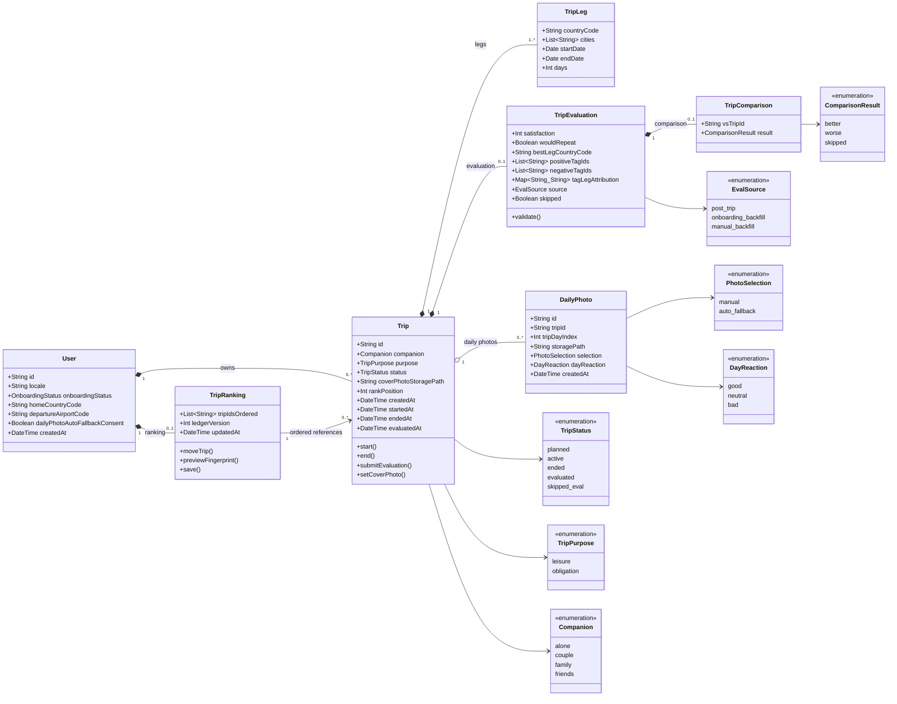
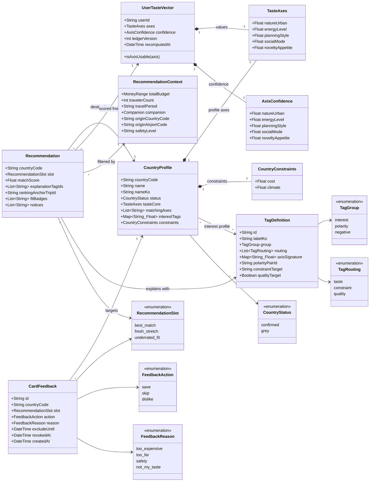
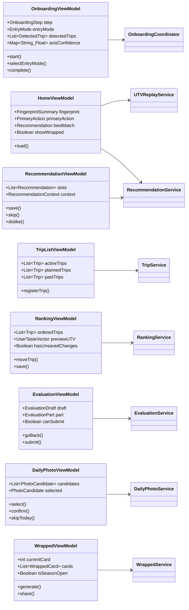
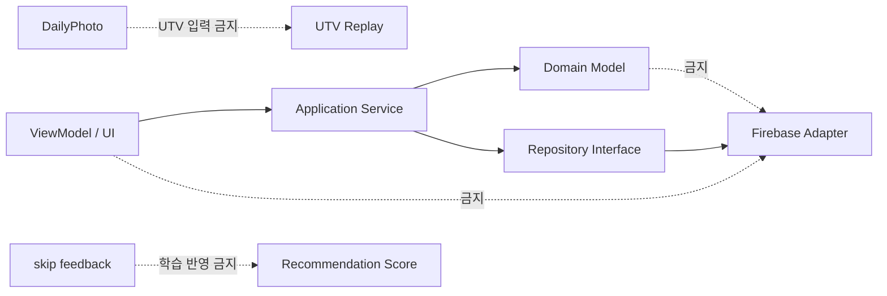

# Travel Fingerprint 3.0 — 클래스 다이어그램

> 기준: [MVP 최종 스펙](./Travel_Fingerprint_3.0_Final_Spec.md)  
> 목적: 구현 전 도메인 경계, 책임, 의존성을 고정한다.  
> 표기: 실제 언어·프레임워크와 무관한 논리 모델이다.

Cursor에서 `Cmd + Shift + V`로 Markdown Preview를 열면 다이어그램으로 볼 수 있다.

---

## 1. 핵심 여행 원장 도메인

### 구현 불변식

- `Trip`이 원장의 기본 단위이며 다국가는 `TripLeg` 여러 개로 표현한다.
- `TripEvaluation`은 여행마다 최대 하나이며 제출 후 MVP에서는 수정하지 않는다.
- 평가·서열은 여행 전체에 한 번만 적용한다.
- `TripRanking`이 순서의 기준이며 `Trip.rankPosition`은 표시용 미러다.
- `DailyPhoto`와 `DayReaction`은 UTV 입력으로 사용하지 않는다.

---

## 2. 취향·국가·추천 도메인

### 추천 반응 규칙

- `save`: 약한 양성 보조 신호다.
- `skip`: 현재 카드만 교체하며 점수·탐험 반경·재노출 확률을 바꾸지 않는다.
- `dislike`: 180일 후보 제외 후에도 강한 감점을 유지한다.
- MVP에서 `CountryConstraints.cost`는 물가 참고 배지일 뿐 예산 적합 판정이 아니다.
- 공항·노선 데이터가 준비되기 전에는 비행시간을 계산하거나 표시하지 않는다.

---

## 3. 애플리케이션 서비스와 저장소

```mermaid
classDiagram
  direction TB

  class OnboardingCoordinator {
    +chooseEntryMode()
    +registerDetectedTrips()
    +registerManualTrip()
    +submitQuiz()
    +calculateConfidenceGate()
    +showFirstFingerprint()
  }

  class AuthService {
    +signInWithApple()
    +restoreAccount()
    +signOut()
    +deleteAccount()
  }

  class PhotoScanService {
    +scanOnDevice()
    +clusterTrips()
    +detectTripLegs()
    +mergeCluster()
    +splitCluster()
    +suggestCoverPhoto()
  }

  class TripService {
    +createTrip()
    +startTrip()
    +endTrip()
    +setCoverPhoto()
    +detectDuplicate()
  }

  class EvaluationService {
    +createDraft()
    +selectComparisonAnchor()
    +submit()
    +skip()
    +attributeTagsToLegs()
  }

  class RankingService {
    +loadRanking()
    +previewMove()
    +saveRanking()
  }

  class UTVReplayService {
    +replayLedger()
    +calculateTripSignal()
    +calculateAxisConfidence()
    +calculateDelta()
  }

  class RecommendationService {
    +generateThreeSlots()
    +applyContextFilters()
    +buildExplanation()
    +replaceSkippedCard()
    +applyFeedback()
  }

  class DailyPhotoService {
    +requestAutoFallbackConsent()
    +selectManualPhoto()
    +selectAutoFallback()
    +removeLocationMetadata()
    +uploadResizedPhoto()
  }

  class WrappedService {
    +isSeasonOpen()
    +generateSixCards()
    +refresh()
    +shareAnnualCard()
    +shareTripCard()
  }

  class TripRepository {
    <<interface>>
    +getTrips()
    +createTrip()
    +updateAllowedFields()
  }

  class RankingRepository {
    <<interface>>
    +getCurrent()
    +saveCurrent()
  }

  class CountryRepository {
    <<interface>>
    +getProfiles()
    +getProfile()
  }

  class FeedbackRepository {
    <<interface>>
    +createFeedback()
    +revokeDislike()
  }

  class PhotoRepository {
    <<interface>>
    +saveMetadata()
    +uploadImage()
    +loadTripPhotos()
  }

  class UTVRepository {
    <<interface>>
    +getCurrent()
    +saveCurrent()
  }

  class EventRepository {
    <<interface>>
    +append()
  }

  OnboardingCoordinator --> AuthService
  OnboardingCoordinator --> PhotoScanService
  OnboardingCoordinator --> TripService
  OnboardingCoordinator --> UTVReplayService
  TripService --> TripRepository
  EvaluationService --> TripRepository
  EvaluationService --> RankingRepository
  EvaluationService --> UTVReplayService
  RankingService --> RankingRepository
  RankingService --> UTVReplayService
  UTVReplayService --> TripRepository
  UTVReplayService --> RankingRepository
  UTVReplayService --> CountryRepository
  UTVReplayService --> UTVRepository
  RecommendationService --> CountryRepository
  RecommendationService --> FeedbackRepository
  RecommendationService --> UTVRepository
  DailyPhotoService --> PhotoRepository
  WrappedService --> TripRepository
  WrappedService --> RankingRepository
  WrappedService --> PhotoRepository
  EvaluationService --> EventRepository
  RankingService --> EventRepository
  RecommendationService --> EventRepository
  DailyPhotoService --> EventRepository
  WrappedService --> EventRepository
```

### 서비스 경계

- 화면은 저장소에 직접 접근하지 않고 애플리케이션 서비스를 호출한다.
- `UTVReplayService`만 원장을 취향 벡터로 변환한다.
- 랭킹 드래그 미리보기는 메모리에서 계산하며 저장소·이벤트를 변경하지 않는다.
- `EvaluationService.submit()` 이후 평가 수정 API는 MVP에서 제공하지 않는다.
- `PhotoScanService`는 위치 분석을 기기 안에서 끝내며 원본 EXIF를 서버로 보내지 않는다.

---

## 4. 화면 상태와 서비스 연결

### 화면 상태 원칙

- 각 ViewModel은 `loading / empty / partial / ready / offline / error`를 공통 상태로 가진다.
- 홈은 간소화 지문, 상태 주행동, 추천 1장, 시즌 Wrapped만 조합한다.
- Wrapped의 `showWrapped`는 12월 15일~다음 해 1월 15일과 여행 존재 조건을 모두 만족해야 한다.
- 로그인은 Apple만 제공하며 인증 성공 전에는 홈으로 이동하지 않는다.

---

## 5. Firestore 매핑

| 클래스 | 저장 위치 |
|---|---|
| `User` | `users/{uid}` |
| `Trip` + `TripLeg` + `TripEvaluation` | `users/{uid}/trips/{tripId}` |
| `TripRanking` | `users/{uid}/ranking/current` |
| `DailyPhoto` | `users/{uid}/dailyPhotos/{photoId}` |
| `CardFeedback` | `users/{uid}/cardFeedback/{feedbackId}` |
| `UserTasteVector` | `users/{uid}/utv/current` |
| `CountryProfile` | `countries/{countryCode}` |
| `TagDefinition` | `tagVocabulary/{tagId}` |

사진 바이너리는 Firestore가 아니라 Firebase Storage의
`users/{uid}/trips/{tripId}/daily/{photoId}.jpg`에 저장한다.

---

## 6. 구현 시 금지되는 의존성

- UI가 Firestore·Storage SDK를 직접 호출하지 않는다.
- 도메인 모델에 Firebase 타입을 노출하지 않는다.
- 하루 한 장을 UTV·국가 프로필 계산에 넣지 않는다.
- 추천 `skip`을 음성 신호로 해석하지 않는다.
- 제출된 평가를 덮어쓰지 않는다.
