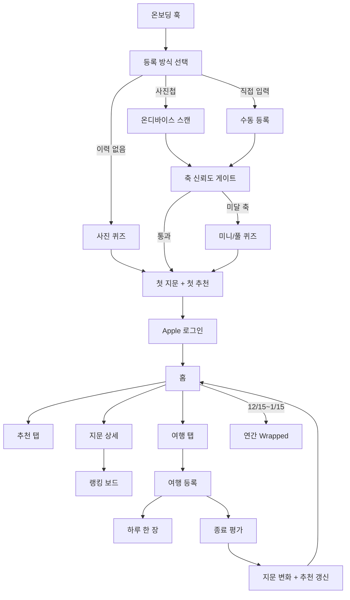

# Travel Fingerprint 3.0 — 최종 스펙 (MVP 고정)

> ⚠️ **이 문서는 2026-09-10에 루트 `README.md`로 대체되었습니다.**
> 목표·범위·개발 순서는 `README.md`를 따르고, 충돌 시 `README.md`가 우선합니다.
> 이 문서는 아래 항목의 **이력 참조용**으로만 남깁니다.
> 변경된 결정: 목표(수익 검증 → 출시·유입), 수익모델(구독 → 제휴 단독),
> 저장(Firebase → SwiftData 로컬), Apple 로그인(필수 → 선택),
> 평가 수정(불가 → 가능), 도시 확장·후보 비교(제외).

> **상태:** 제품·UI 결정 고정본  
> **기준일:** 2026-07-24  
> **역할:** 개발 착수 시 읽는 단일 진입 문서  
> **상세 산식·스키마·화면 세부:** 하단 [상세 문서](#12-상세-문서-인덱스) 참고

이 문서는 최근 확정한 제품 결정을 반영한 MVP 최종본입니다.  
알고리즘·신호 모델의 깊은 정의는 [Travel_Fingerprint_3.0_Spec.md](./Travel_Fingerprint_3.0_Spec.md)와 `spec/` 하위 문서를 따릅니다.  
문서 간 충돌 시 **이 문서의 제품·UI 고정 결정이 우선**합니다.

---

## 0. 한 줄 정의

**다녀온 여행으로 취향 지문을 만들고, 다음 여행지 3개를 설명과 함께 추천하는 앱.**

모든 입력의 판단 기준은 하나입니다.  
**“다음 여행지 예측의 정확도를 올리는가.”**

---

## 1. MVP 고정 결정

| # | 항목 | 고정값 |
|---|---|---|
| 1 | 하단 탭 | `홈 / 추천 / 여행` |
| 2 | 로그인 | **Apple만**. Google·게스트 없음 |
| 3 | 온보딩 시작 | `사진첩 자동 찾기 / 직접 입력 / 사진 퀴즈`를 **동등 선택** |
| 4 | 홈 구성 | 간소화 지문 + 상태 주행동 + 추천 1장 + (시즌) Wrapped |
| 5 | 랭킹 | 여행 단위 드래그. **드래그 중 지문 미리보기**, 저장 시 최종 재생 |
| 6 | 추천 반응 | `저장` / `스킵`(재노출 확률 유지) / `싫어요`(거의 안 나옴) |
| 7 | 예산·비행 | MVP는 **물가 참고 배지만**. 비행시간·예산 적합 단정 금지 |
| 8 | 연간 Wrapped | **6장**, 노출 **12/15 ~ 다음 해 1/15** |
| 9 | 개별 여행 공유 | 여행 상세에서 **연중** 가능 |
| 10 | 다국가 | 등록·스캔·평가 모두 지원. 평가는 **여행 1회** + 베스트 국가 + 태그 귀속 |
| 11 | 하루 한 장 자동 후보 | 첫 여행의 첫 하루 한 장 확정 후 **1회 동의** |
| 12 | 사진 보관 | Firebase Storage (EXIF 위치 제거, 리사이즈본) |
| 13 | 여행 대표 사진 | 종료 후 하루 한 장 우선 제안, 사진첩 교체 가능 |
| 14 | 평가 수정 | 제출 전 수정 OK. **제출 후 MVP 수정 없음**. 서열 교정은 랭킹 |

---

## 2. 전체 플로우

---

## 3. 내비게이션·공통 규칙

### 3.1 탭

1. **홈** — 지문 요약, 최우선 다음 행동, 추천 1장, (시즌) Wrapped  
2. **추천** — 3슬롯, 필터, 저장 목록  
3. **여행** — 현재/예정/지난 여행, 등록  

- 랭킹 보드: 지문 상세에서 진입  
- 설정·계정: 홈 상단 프로필  
- 한 화면 주 CTA 1개  
- 입력 화면에서 뒤로가기·건너뛰기 숨기지 않음  
- 권한 다이얼로그 전 이유·데이터 경계 설명  
- 여행 중 **취향 질문 금지** (하루 한 장은 기록용, UTV 미반영)

### 3.2 공통 상태

`loading` · `empty` · `partial` · `ready` · `offline` · `error`

---

## 4. 화면별 기능 (개발 체크리스트)

### UI-1. 취향 온보딩

**목적:** 첫 지문 + 첫 추천을 로그인 전에 보여준다.

| 화면 | 기능 |
|---|---|
| 훅 | 가치 선언, 예시 지문, 시작 |
| 등록 방식 선택 | 사진첩 자동 찾기 / 직접 입력 / 사진 퀴즈 |
| 사진첩 경로 | 프라이밍 → 권한 → 온디바이스 스캔 → 여행 카드 확인 |
| 스캔 카드 | 만족도 1~5, 2번째부터 서열 비교, 다국가 legs 제안, 합치기/나누기, 여행별 대표 사진 |
| 직접 입력 | 국가·시기·만족도 (+선택 태그) |
| 퀴즈 | A/B 12 + Q13 + 관심사(최대 3). 축 신뢰도 게이트로 미달 축만 출제 |
| 결과 | 지문 합성 → 5축 지문 → 첫 추천 3슬롯 축약 |

완료 조건: 지문·첫 추천 노출 후 UI-2로 이동.

### UI-2. Apple 로그인

| 기능 | 고정 |
|---|---|
| 제공자 | Apple만 |
| 게스트/Google | 없음 |
| 시점 | 첫 지문·추천 확인 **이후** |
| 성공 | 온보딩 임시 데이터 ↔ `uid` 연결 → 홈 |
| 계정 | 로그아웃, 계정 삭제(영향 범위 안내) |
| 복구 | 기존 계정과 임시 온보딩 병합은 유저 확인 후 |

### UI-3. 홈 · 지문 · 랭킹

**홈 (한 화면 우선)**

1. 상단 바 (인사, 프로필, 동기화)  
2. 간소화 지문 → 탭 시 상세  
3. 상태 주행동 카드 (평가 대기 / 하루 한 장 / 예정 / 새 등록)  
4. 추천 1장 (`best_match`) → 추천 탭  
5. Wrapped — **12/15~1/15** 이고 해당 연도 여행 ≥1일 때만  

**지문 상세**

- 5축, 신뢰도, 근거 여행/태그  
- 조건부축 안내: 추천 매칭 미사용  
- 축 슬라이더 직접 수정 **없음**  
- CTA: 랭킹 보드  

**랭킹 보드**

- 여행 단위 드래그  
- 드래그 중 미니 지문 **실시간 미리보기**(로컬 임시)  
- `이 순서로 저장` 시에만 UTV 재생·이벤트  
- 여행 상세: 결과/태그/대표 사진/`공유하기`

### UI-4. 추천

| 항목 | 고정 |
|---|---|
| 슬롯 | `best_match` / `fresh_stretch` / `underrated_fit` |
| 카드 액션 | 저장 · 스킵 · 싫어요 (항상 노출) |
| 스킵 | 현재 카드만 교체. 학습·탐험 반경·재노출 확률 **변경 없음** |
| 싫어요 | 180일 제외 + 이후 강한 감점. 설정에서만 해제 |
| 필터 | 예산 범위(선택), 시기, 동행, 출발지(프로필). 비행 필터는 노선 데이터 준비 전 **숨김** |
| 현실 적합 | Match Score와 분리. MVP는 물가 참고 배지만 |
| 상세 | 왜 추천 / 현실 / 알아둘 점 |
| 저장 목록 | 이유 유지, 여행 등록, 해제 |

### UI-5. 연간 Wrapped

| 항목 | 고정 |
|---|---|
| 노출 | **12월 15일 ~ 다음 해 1월 15일** |
| 구성 | 6장 (이동 / 1위 / 강한 취향 / 태그 / 사진 / 공유) |
| 기간 밖 | 홈·배너·앱 내 다시 보기 **숨김** |
| 갱신 | 시즌 중 원장 변경 시 `업데이트해서 다시 보기` |
| 개별 여행 공유 | Wrapped가 아님. 여행 상세에서 연중 |

### UI-6. 여행 등록

| 기능 | 내용 |
|---|---|
| 목록 | 현재 / 예정 / 지난 |
| 등록 시작 | 지금·예정 / 과거(사진첩·직접) |
| 폼 | 국가·도시·기간·다국가 legs·동행·여행/의무 |
| 사진 스캔 | 다국가 군집, 합치기/나누기, **여행별 대표 사진** |
| 과거 수동 | `evalSource=manual_backfill` |
| 알림 권한 | **첫 예정·현재 여행 등록 직후**에만 요청 |
| 상세 | 시작/하루 한 장/종료/평가/공유 |
| 감지 | 도착 넛지 → 프리필 등록 (중복 무시) |

### UI-7. 하루 한 장

| 항목 | 고정 |
|---|---|
| 입력 | 오늘 사진 중 1장 선택 + 선택 반응 |
| UTV | **절대 미반영** |
| 자동 후보 | 첫 여행 첫 확정 후 1회 동의. 거부 시 미선택 날 비움 |
| Storage | EXIF 위치 제거, 리사이즈본만 유저 경로 업로드 |
| 금지 | 축/태그 질문, 스트릭·배지·추궁 |

### UI-8. 여행 종료 평가

**단일 국가:** 시작 → 만족도 → 재방문 → 비교 → 좋았던 태그 → 아쉬웠던 태그 → 지문 변화 → (선택) 대표 사진  

**다국가:** 위 + 베스트 국가 + taste 태그별 국가 귀속  

| 항목 | 고정 |
|---|---|
| 평가 단위 | **여행 1건** (국가마다 풀 평가 반복 안 함) |
| 스킵 | 방문 사실만 기록, 반영 상한 하향 |
| 제출 후 수정 | MVP **없음**. 서열은 랭킹으로 교정 |
| 대표 사진 | 하루 한 장 우선, 사진첩 교체, 연중 공유 카드 |

---

## 5. 취향·신호 모델 (요약)

상세: [3.0 코어 스펙](./Travel_Fingerprint_3.0_Spec.md),
[signal/02](../../spec/signal/02-signal-quality-and-aggregation.md)

### 5.1 3계층

1. **Taste Core** — `natureUrban`(확정 매칭) + 조건부축 4개  
2. **Interest Tags** — 평가 귀속 태그  
3. **Trip Constraints** — 상황 필터/현실 적합 (개인값 + 국가 공개데이터)

### 5.2 취향 입력 접점

| 접점 | 역할 |
|---|---|
| 온보딩 과거 등록 / 퀴즈 | 콜드스타트 |
| 여행 종료 평가 | 판정 + 서열 + 귀속 |
| 랭킹 보드 | 과거 라벨 교정 |
| 추천 카드 반응 | `save`/`dislike`만 보조 신호. `skip`은 UI만 |
| 하루 한 장 | 기록만. UTV 미반영 |

### 5.3 UTV

- 진짜 데이터 = 여행 원장  
- UTV = 원장 날짜순 결정적 재생(캐시)  
- 재생 트리거: 평가 확정, 랭킹 **저장**, 온보딩 완료  

### 5.4 Profile_x

- Stage 0: 편집 동결 30개국  
- Stage 0.5+: 표본 도달 시 태그 리프트부터 승격  

---

## 6. 추천 (요약)

| 슬롯 | 의미 |
|---|---|
| `best_match` | 가장 잘 맞음 |
| `fresh_stretch` | 취향 하한 통과 + 탐험 |
| `underrated_fit` | 저인기 + 관심사·현실 적합 |

- 설명 우선순위: 유저 태그 인용 → 랭킹 앵커 → 축 폴백  
- Match Score ≠ 현실 적합도 (합산 금지)  
- 현재 국가 데이터: `constraints.cost`(물가), `constraints.climate`  
- **비행시간 하드코딩 금지.** 공항·노선 데이터 도입 전까지 UI 숨김  
- 후속 후보: 공항 좌표, 도심 이동시간, 직항/경유, 수하물 수취 범위  

---

## 7. 데이터 · 인증 · 사진

상세: [spec/data/10-firestore-schema.md](../../spec/data/10-firestore-schema.md)

### 7.1 인증

- Firebase Auth **Apple Sign In만**  
- Firestore 쓰기는 로그인 유저만  

### 7.2 핵심 컬렉션

| 경로 | 용도 |
|---|---|
| `countries/{code}` | 국가 프로필(읽기 전용) |
| `tagVocabulary/{tagId}` | 태그 어휘(읽기 전용) |
| `users/{uid}` | 메타, 자동후보 동의, 출발지 |
| `users/{uid}/trips/{tripId}` | 여행 원장 |
| `users/{uid}/ranking/current` | 랭킹 스냅샷 |
| `users/{uid}/dailyPhotos/{id}` | 하루 한 장 메타 |
| `users/{uid}/cardFeedback/{id}` | 저장/스킵/싫어요 |
| `users/{uid}/events/{id}` | append-only 분석 |

### 7.3 평가 출처 `evalSource`

- `post_trip` — 종료 평가  
- `onboarding_backfill` — 온보딩 과거 등록  
- `manual_backfill` — 앱 사용 중 과거 추가  

### 7.4 사진 Storage

- 경로 예: `users/{uid}/trips/{tripId}/daily/{photoId}.jpg`  
- 여행 대표: `trips.coverPhotoStoragePath`  
- EXIF 위치 제거, 원본 미업로드, 본인 경로만 읽기·쓰기  
- Storage Rules 파일은 구현 단계에서 추가  

### 7.5 원장 규칙

- `legs` / `createdAt` 생성 후 불변  
- 상태·평가·`rankPosition` 미러·대표 사진만 점진 업데이트  
- 평가 제출 후 수정 UI 없음 (MVP)  
- 랭킹 이력 = `ranking/current` + `ranking_adjusted` 이벤트  

---

## 8. 권한 타이밍

| 권한 | 시점 |
|---|---|
| 사진첩 | 유저가 **사진첩 경로를 선택한 뒤** 프라이밍 → 시스템 요청 |
| 알림 | **첫 예정·현재 여행 등록 직후** (온보딩 끝에서 요청하지 않음) |
| 위치 | 설정/도착 감지. 강제 아님 |

---

## 9. 이벤트 (MVP)

상세: [spec/analytics/05-kpi-and-events.md](../../spec/analytics/05-kpi-and-events.md)

핵심:  
`trip_started` · `trip_evaluated` · `ranking_adjusted` · `utv_recomputed` ·  
`daily_photo_selected` · `recommendation_feedback` ·  
`wrapped_*` · `trip_card_shared` · 슬롯 impression/click/save  

- 랭킹 드래그 미리보기: **이벤트 없음**  
- `ranking_adjusted` / `utv_recomputed(rank_edit)`: 저장 CTA만  

---

## 10. 로드맵

| 단계 | 범위 |
|---|---|
| **MVP (Stage 0)** | 이 문서의 전체 범위. Profile_x 동결 |
| Stage 0.5 | 태그 리프트로 Interest Profile 승격 |
| v1.5 | 스토리/순간기록, Wrapped 리치화 (데이터 근거로 승격) |
| Stage 1 | 국가 내부 지역 확장 |
| Stage 2 | CF/세그먼트 강화 |

후속 데이터(명시만, MVP 밖): 공항 DB, 노선·비행시간, 총예산 적합, 비자·안전 정교화.

---

## 11. 미결 (개발 차단이 아닌 튜닝·콘텐츠)

제품 범위는 고정. 아래만 구현 중/후에 확정한다.

1. g(s̃) 곡선·축별 게인 초기값 (원격 설정)  
2. `noveltyAppetite` ↔ `noveltyDistance` 매칭식  
3. 온보딩 A/B 퀴즈 사진 세트 제작  
4. 파일럿 검수 재현성 허용 범위  
5. 재열람 인정 최소 경과 시간  
6. Firebase Storage Rules / 계정 삭제 운영 절차  

---

## 12. 상세 문서 인덱스

| 문서 | 내용 |
|---|---|
| [Travel_Fingerprint_3.0_Class_Diagram.md](./Travel_Fingerprint_3.0_Class_Diagram.md) | 도메인·서비스·저장소·화면 상태 클래스 다이어그램 |
| [Travel_Fingerprint_3.0_Spec.md](./Travel_Fingerprint_3.0_Spec.md) | 신호·UTV·Profile·추천 원칙 본문 |
| [spec/README.md](../../spec/README.md) | 실행 스펙 폴더 목차 |
| [spec/ui/detail/README.md](../../spec/ui/detail/README.md) | 화면별 상세 UI |
| [UI-01](../../spec/ui/detail/UI-01-taste-onboarding.md) ~ [UI-08](../../spec/ui/detail/UI-08-trip-evaluation.md) | 화면 단위 스펙 |
| [signal/02](../../spec/signal/02-signal-quality-and-aggregation.md) | UTV 재생 산식 |
| [recommendation/04](../../spec/recommendation/04-slot-explainability.md) | 3슬롯 설명 |
| [recommendation/06](../../spec/recommendation/06-tag-vocabulary.md) | 태그 어휘 |
| [analytics/05](../../spec/analytics/05-kpi-and-events.md) | KPI·이벤트 |
| [data/10](../../spec/data/10-firestore-schema.md) | Firestore 스키마 |
| [pilot/01](../../spec/pilot/01-country-profiles-and-axis-diagnostics.md) | 30개국 파일럿 |

---

## 13. 개발 착수 순서 (권장)

1. Auth(Apple) + Firestore 스키마/Rules  
2. 온보딩(방식 선택 → 등록/퀴즈 → 지문 → 로그인)  
3. 여행 원장 CRUD + 홈/탭 골격  
4. 종료 평가 + UTV 재생(클라이언트) + 지문 델타  
5. 랭킹 보드(미리보기 + 저장 재생)  
6. 추천 3슬롯 + 피드백 정책  
7. 하루 한 장 + Storage  
8. 여행 공유 카드  
9. 연간 Wrapped(시즌 게이트)  
10. 여행 감지·알림 배관  

---

**이 문서가 MVP 제품·UI의 최종 고정본이다.**  
세부 구현은 `spec/ui/detail/*`와 `spec/data/*`를 따르고, 충돌 시 이 문서의 §1·§4를 우선한다.
