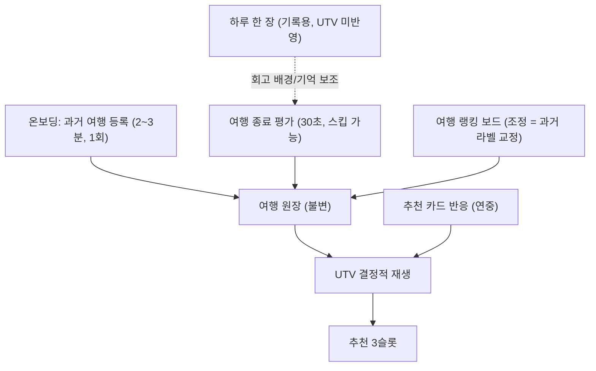

# Travel Fingerprint 3.0 스펙 (신호·모델 본문)

> 2.0(여행 중 사진+원탭, 종료 시 5축 슬라이더 회고)을 대체하는 모델 본문입니다.
> **제품·UI 고정 결정과 개발 체크리스트는**
> [Travel_Fingerprint_3.0_Final_Spec.md](./Travel_Fingerprint_3.0_Final_Spec.md)가 우선합니다.
> 3.0의 핵심 전환: **여행 중 취향 입력을 MVP에서 제외**하고(기록용 "하루 한 장"만 유지, 2.6절),
> 평가를 "판정 + 서열 + 귀속" 30초 구조로 재설계했으며, UTV를 **여행 원장 기반 재생(replay) 모델**로 바꿨습니다.

---

## 0. 설계 원칙과 개편 요약

앱의 핵심은 여행지 추천입니다. 모든 입력은 단 하나의 기준으로 판단합니다:
**"다음 여행지 예측의 정확도를 올리는가."**

추천기가 필요로 하는 최소 충분 데이터는 세 가지뿐입니다.

1. **라벨** — 유저가 각 여행을 얼마나 좋아했는가 → 판정 + 서열로 수집
2. **귀속** — 왜 좋았고/아쉬웠는가 → 긍정/부정 태그로 수집
3. **국가 서술** — 각 나라가 어떤 곳인가 → 유저가 아닌 편집(파일럿) + 공개데이터가 담당

유저에게는 유저만 답할 수 있는 것(1, 2)만 묻고, 시스템이 알 수 있는 것(3)은 묻지 않습니다.

| 구분 | 2.0 | 3.0 |
|---|---|---|
| 여행 중 입력 | 사진 + 원탭 반응 (moment_logged) | **취향 신호 없음** — 하루 한 장 대표 사진(기록용, UTV 미반영)만. 스토리/신호 승격은 v1.5 |
| 여행 종료 평가 | 사진 회고 + 5축 슬라이더 | **판정(만족도+wouldRepeat) + 서열(직전 여행 비교 원탭) + 귀속(긍정 태그 ≤5, 부정 태그 ≤3)**, 30초, 스킵 가능 |
| 콜드스타트 | 없음 (첫 여행 후부터 학습) | **온보딩에서 과거 여행 등록** → 첫날부터 지문/추천 생성 |
| UTV 저장 구조 | 증분 EMA 누적 상태 | **불변 여행 원장 + 결정적 재생(replay)** — 랭킹 수정 시 안전한 재계산 |
| 만족도 캘리브레이션 | 절대값(1~5) 그대로 사용 | **서열 보정 s̃_t** — 본인 여행 내 상대 백분위로 변환 |
| 음성 신호 | 사실상 없음 (양성 쏠림) | **부정 태그 + 카드 '싫어요' + 서열 하위 여행** 3원 확보 |
| 여행 랭킹 | 없음 | **유저가 보고 조정 가능한 랭킹 보드** (Wrapped·추천 설명 재사용) |
| Profile_x 갱신 | 명시 안 됨 | **2단계: 편집 동결(Stage0) → 표본 도달 시 태그 리프트 집계 승격** |

취향 모델 3계층(Taste Core 5축 / Interest Tags / Trip Constraints), 추천 스코어 구성,
3슬롯, 램프업 가중치, 베이지안 수축, 상황 필터는 2.0 구조를 유지합니다(6절).

---

## 1. 취향 모델: 3계층 (2.0 유지)

### 1.1 Taste Core (코사인 매칭 축)

| 축 | 정의 | 범위 | 매칭 가중치 |
|---|---|---|---|
| `natureUrban` | 자연 중심 ↔ 도시 중심 | -1.0 ~ 1.0 | 1.0 확정 |
| `energyLevel` | 고요/휴식 ↔ 활동/자극 | -1.0 ~ 1.0 | 조건부 (파일럿 필터1+2) |
| `planningStyle` | 즉흥 ↔ 계획 | -1.0 ~ 1.0 | 조건부 (파일럿 필터1+2) |
| `socialMode` | 혼자/소수 몰입 ↔ 사람 많은 경험 | -1.0 ~ 1.0 | 조건부 (파일럿 필터1+2) |
| `noveltyAppetite` | 익숙함 선호 ↔ 새로움 선호 | -1.0 ~ 1.0 | 조건부 (유저분산 필터만, 국가측은 `noveltyDistance`) |

조건부 축은 파일럿 실패 시에도 UTV/Wrapped용 수집은 계속합니다(기존 규칙 유지).

### 1.2 Interest Tags / 1.3 Trip Constraints

2.0 정의 그대로 유지합니다. 단, Interest Tags의 신호 소스가 "회고 보조 질문/원탭 이유 칩"에서
**평가의 귀속 태그**로 일원화됩니다. Trip Constraints(`budgetFit`, `seasonFit`, `safetyFloor`,
`flightFriction`, `visaFriction`, `companionFit`)는 변경 없음.

### 1.4 축 추가/제거 체크리스트 (개정 1건)

2.0의 "계층 분류 → 사전체크 → 4개 필터" 절차에 다음을 추가합니다.

- **태그 어휘 커버리지**: Taste Core 후보 축은 태그 어휘([spec/06](../../spec/recommendation/06-tag-vocabulary.md))에
  **양극 태그 쌍이 최소 1쌍** 존재해야 함. 귀속 태그가 유일한 축 계측 수단이므로,
  어휘에 없는 축은 계측 불가 = 축 편입 불가.

---

## 2. 입력: 취향 신호 접점 3개 + 랭킹 보드 + 기록 접점 1개

여행 중 **취향 입력**은 없습니다. 모든 취향 입력은 원탭/태그 선택이고,
여행 중에는 기록용 "하루 한 장"(2.5절, UTV 미반영)만 존재합니다.



### 2.1 온보딩: 과거 여행 등록

첫 화면에서 **사진첩 위치 스캔 / 직접 입력 / 여행 이력 없음** 중 하나를 유저가 고릅니다.
사진첩 권한 요청을 기본 경로로 강제하지 않습니다.

- **선택 A — 사진 위치 스캔**: 이 방식을 고른 뒤 "다녀온 곳을 지도에서 찾아드릴까요?" 가치 제안을
  보여준 뒤 사진첩 권한 요청(프라이밍). **온-디바이스**로 사진의 위치 태그를 군집화해
  해외 방문지를 세계 지도 핀으로 표시(위치 데이터 서버 전송 없음 — 이 경계가 권한 수락률을
  좌우). 핀을 탭하면 국가+시기가 EXIF에서 자동 완성되고 유저는 **만족도 원탭만** 남깁니다
  — 여행당 5~10초. 위치·날짜가 이어진 군집은 여행 1건으로 묶고 국경 이동은 다국가
  `legs`로 제안하며, 유저가 합치기·나누기·대표 사진 교체를 할 수 있습니다. 여기서 받은
  사진첩 권한은 하루 한 장(2.6절)이 재사용합니다.
- **선택 B — 수동 등록**: 처음부터 선택하거나 권한 거부·위치 태그 부재 시. 국가 검색 + 대략적 시기 +
  판정(만족도 원탭) + 귀속 태그(선택)를 여행당 20~30초로 등록. 다국가는 `나라 추가`로 구간을 붙일 수 있다.
- **선택 C — 여행 이력 없는 유저**: 여행 사진 A/B 탭 선택 퀴즈(spec/09, 13문항) → 초기 UTV(신뢰도 하향 플래그).
- 스캔·수동 모두 다국가 `legs`를 지원한다. 등록 완료율이 정밀도보다 우선이므로 오탐 군집은
  합치기/나누기로 빠르게 고치게 한다.
- 3~5개만 등록해도 첫 지문이 그려지고 **첫날부터 추천이 나옵니다** (콜드스타트 해소).
- 등록 순서대로 원탭 서열 비교를 끼워 넣어 초기 랭킹을 만듭니다.

### 2.2 여행 종료 평가 — `trip_evaluated` (30초, 스킵 가능)

세 파트로 구성됩니다.

1. **판정**: 만족도 원탭(1~5) + `wouldRepeat`(또 가고 싶은가).
   **다구간 여행이면** "가장 좋았던 나라는?" 원탭 1개 추가 (구간 2개 이상일 때만 노출).
2. **서열**: "예전 {앵커 여행지}와 비교하면 어땠나요?" 원탭 1개. 유저 내부 여행 랭킹에 삽입.
   절대 만족도의 유저 간 스케일 차이(누군가의 4점 = 다른 사람의 5점)를 제거하는 **캘리브레이션 장치**.
   **동적 앵커**: 비교 대상은 시간순 직전 여행이 아니라 ①방금 준 만족도와 같은 점수대의
   과거 여행 중 ②의무 여행(출장·행사) 제외 ③가장 최근 것. 같은 점수대 내부의 서열을
   가르는 질문이라 원탭 1회의 백분위 삽입 정보량이 최대("5점 vs 2점" 비교는 답이 뻔해
   정보량 0). 같은 점수대에 후보가 없으면 인접 점수대 → 그래도 없으면 직전 여가 여행 폴백.
   첫 여행(비교 대상 없음)이면 이 스텝은 자동 생략.
3. **귀속**: "특히 좋았던 것" 태그 최대 5개 + "아쉬웠던 것" 태그 최대 3개(선택).
   태그 어휘와 축 서명은 [spec/06](../../spec/recommendation/06-tag-vocabulary.md) 참고.
   **다구간 태그 나라 귀속**: 구간 2개 이상이면 taste 라우팅 태그에 한해 "어느 나라였어요?"
   나라 칩 원탭을 붙입니다(다구간 여행만 +5~10초, 30초 예산은 단일 구간 기준 유지).
   태그 게인이 귀속 구간에만 반영되어 혼합 벡터 오염(Attribution Blur, 리스크 #9)을
   방지합니다. 귀속을 생략한 태그는 베스트 구간 가중 배분 폴백(spec/02).
   판정·서열은 여행 단위 유지 — 원장·랭킹 보드·s̃_t의 단위("포르투갈·스페인" = 여행 1개)는
   바뀌지 않습니다.

```json
{
  "event": "trip_evaluated",
  "tripId": "string",
  "legs": [{ "countryCode": "string", "cities": ["string"], "days": "int" }],
  "bestLegCountryCode": "string | null  (구간 2개 이상일 때만)",
  "timestamp": "ISO8601",
  "satisfaction": "int 1~5 | null",
  "wouldRepeat": "boolean | null",
  "comparison": { "vsTripId": "string | null", "result": "better | worse | skipped" },
  "positiveTags": ["string, 최대 5개"],
  "negativeTags": ["string, 최대 3개"],
  "tagLegAttribution": { "태그명": "countryCode | null  (다구간 + taste 태그만, 생략 가능)" },
  "source": "post_trip | onboarding_backfill | manual_backfill",
  "skipped": "boolean"
}
```

- 평가 화면 배경에 **하루 한 장 사진들**(2.5절)을 날짜순으로 깔아 기억을 소환합니다.
  일별 원탭 반응은 "가장 좋았던 날" 후보 정렬과 서열 질문의 기억 보조로만 사용.
- 스킵 시: 방문 사실만 원장에 기록, s̃_t는 유저 중앙값으로 대체하고 해당 여행의 반영 상한을 낮춤.
- **부정 태그 3갈래 라우팅** (태그별 사전 지정, spec/06):
  - 취향 신호 → UTV 축 (예: `너무 북적였다` → socialMode)
  - 상황 신호 → Constraints 개인값 (예: `날씨가 아쉬웠다` → seasonFit, `예상보다 비쌌다` → budgetFit 민감도)
  - 품질 신호 → 국가 품질 점수 (예: `바가지/불친절`, `위생`) — **취향 축을 오염시키지 않음**

### 2.3 추천 카드 반응 — `recommendation_feedback` (2.0 유지)

저장/스킵/싫어요. 여행 없는 기간의 유일한 학습·체감 신호이므로 **'싫어요'를 UI에서 숨기지 않습니다**
(음성 신호 확보). 스키마는 2.0과 동일.

- `skip`: 현재 카드 교체만 수행하며 취향 점수·탐험 반경·향후 재노출 확률은 바꾸지 않습니다.
- `dislike`: 180일간 일반 후보에서 제외하고 이후에도 강하게 감점합니다. 설정에서 직접 해제할
  수 있어야 하며, 상황성 이유라도 필터 변경만으로 자동 복원하지 않습니다.

### 2.4 여행 랭킹 보드

- 서열 원탭들이 만든 랭킹을 유저가 **보고, 드래그로 조정**할 수 있는 화면.
- 조정은 노이즈가 아니라 **과거 라벨의 교정**입니다. 조정 시 UTV를 원장에서 재생(4절)하고,
  "랭킹 조정으로 지문이 이렇게 변했어요" 델타를 보여줍니다(체감 루프).
- 드래그 중에는 로컬 임시 계산으로 미니 지문의 예상 변화를 보여주고, 저장할 때만 원장 전체를
  재생해 최종값을 확정합니다.
- 백분위 기반이라 인접 순위 교환은 UTV를 거의 움직이지 않습니다(자연 안정성).
- Wrapped("올해의 여행 1위"), 추천 설명("당신의 역대 1위 조지아와 닮은 나라")에 재사용.

### 2.5 여행 등록 (여행 시작) — `trip_started`

사실만 받습니다. 무드/목적 태그(구 Trip Mode)는 **폐지** — 추천 컨텍스트 역할은
추천 화면의 상황 필터가 이미 수행하므로, 목적지를 정한 뒤인 이 시점엔 갈 곳이 없는 입력입니다.

| 필드 | 형식 | 용도 |
|---|---|---|
| 구간(legs) | [{국가(DB 검색), 도시(선택, 복수), 시작일, 종료일}] 1개 이상 | **다국가 여행 지원.** 원장의 기본 단위 |
| 동행 | 원탭: 혼자/커플/가족/친구 | `companionFit` + 평가 해석 보정(socialMode 오귀속 방지) |
| 여행 성격 | 원탭: 여행(기본) / 출장·행사 등 의무 | **의무 여행의 UTV 오염 방지** — 원장 기록은 하되 반영 가중치 대폭 하향 (spec/02) |

- **국가**: 파일럿 확정국 + 회색 처리국 포함 전체 목록에서 검색. 프로필 미확정 국가도
  **등록은 항상 가능** (기록은 되고, UTV 반영만 프로필 승격 시까지 보류).
- **도시**: 선택 입력, 스킵 가능. MVP에서는 매칭에 쓰지 않고 **원장에 축적만** —
  Stage 1 지역 확장의 "국가 내부 편차" 데이터가 첫날부터 쌓이게 하는 장치.
- 종료일이 평가 유도 알림의 최소 배관. 알림 권한 요청은 이 화면 완료 직후(맥락 프라이밍).

### 2.6 여행 중: 하루 한 장 + 여행 감지 (기록 접점, 취향 신호 아님)

여행 중 접점 0으로 인한 두 구멍(평가 트리거 부재, 회고 시 기억 재료 부재)을 메우는
기능입니다. **바닥(자동)과 천장(수동)을 분리**해, 놓쳐도 망가지지 않게 설계합니다.

- **천장 — 하루 한 장 고르기**: 하루 끝 가벼운 알림 → 사진첩에서 대표 사진 1장 선택
  (촬영이 아니라 **큐레이션**) + 원탭 반응(좋았어/그럭저럭/별로, 선택 사항).
- **바닥 — 자동 후보 폴백**: 첫 여행의 첫 하루 한 장 확정 뒤 유저가 한 번 동의한 경우에만,
  건너뛴 날은 EXIF 날짜 기준으로 후보를 자동 선정. 동의는 설정에서 변경할 수 있습니다.
  아무것도 안 한 유저도 종료 평가 때 날짜별 사진이 깔린 회고를 받습니다.
- **사진 동기화**: 확정 사진은 EXIF 위치를 제거하고 화면용으로 리사이즈해 유저 전용 Firebase
  Storage에 저장합니다. 다른 Apple 기기에서도 조회하되 원본은 업로드하지 않습니다.
- **압박 장치 없음**: 스트릭/배지/미선택 경고 금지. 죄책감 → 앱 회피 루프 차단.
- **여행 감지**: 여행 등록 시 종료일 수령(최소), 캘린더/위치 권한 시 자동 감지(권장). 두 방향입니다.
  - **시작 감지 — 도착 넛지**: 위치 권한 허용 유저가 생활 반경을 벗어나 타국 도착이 감지되면
    (Significant Location Change / Region Monitoring 수준의 저전력 감지)
    "파리에 도착하셨군요! 여행 기록을 시작할까요?" 넛지 알림 → 여행 등록(2.5절)으로 연결.
    **수동 등록을 놓친 유저의 배관 붕괴 방어** — 등록이 없으면 하루 한 장 알림도
    종료 평가 알림도 영영 오지 않으므로, 이 넛지가 루프 전체의 안전망입니다.
    이미 등록된 여행과 겹치는 도착은 알림 없이 무시(중복 넛지 금지).
  - **종료 감지**: 등록된 종료일 도달 또는 귀국 감지 → 평가 유도 알림. 이 기능의 핵심 배관입니다.

```json
{
  "event": "daily_photo_selected",
  "tripId": "string",
  "tripDayIndex": "int",
  "photoId": "string",
  "selection": "manual | auto_fallback",
  "dayReaction": "good | neutral | bad | null",
  "timestamp": "ISO8601"
}
```

**경계 규칙 (중요)**: 이 이벤트는 MVP에서 **UTV·Profile_x에 절대 반영하지 않습니다.**
사진과 원탭 반응은 (a) 종료 평가의 회고 배경·"가장 좋았던 날" 정렬, (b) Wrapped 라이트 재료,
(c) v1.5에서 "일별 반응을 신호로 승격할지"를 데이터로 판단하기 위한 축적 — 세 용도뿐입니다.
축 질문·태그를 여기에 붙이는 순간 "여행 중 입력은 신호가 아니다"라는 MVP 결정이
뒷문으로 무너지므로 금지합니다.

---

## 3. 국가 프로필 Profile_x: 동결 → 승격 2단계

### Stage 0 (MVP): 편집 동결

- LLM 초안 → 2인 검수 → 30개국 파일럿(코사인 0.7 + 확장 기준) 파이프라인으로 확정한
  편집 프로필 + 공개데이터(Constraints)만 사용. **유저 데이터로 움직이지 않습니다.**
- 근거: 베이지안 수축 k≈15 기준으로 MVP 규모에서는 어차피 표본 미달. 동결이 정직한 선택.
- 유저의 귀속 태그·판정은 이 기간에도 **쌓기만** 합니다.
- 이 구조에서는 편집 프로필이 추천 품질의 단일 실패 지점이므로, 파일럿 게이트("조건부 GO")가
  더 무거워집니다. 파일럿 스펙은 [spec/pilot/01](../../spec/pilot/01-country-profiles-and-axis-diagnostics.md).

### Stage 1 승격 (국가당 평가 15~30개 도달 시)

1. **Interest Tag Profile부터**: 태그 선택률을 전 국가 평균 대비 **리프트**로 정규화해 갱신
   (예: 일본 `food` 선택률 60% ÷ 전체 평균 35% = 리프트 1.7 → 강한 신호). 직접 관측이라 가장 안전.
2. **Taste Core 축은 보수적으로**: 양극 태그 집계 + 베이지안 수축 + **이동 상한 ±0.15**(편집 사전값 기준).
   추천이 방문자를 고르고 방문자가 프로필을 움직이는 자기강화 루프 방어.
3. **편집값과 유저 집계가 크게 어긋나는 국가는 자동 재검수 플래그** — 유저 데이터가 프로필을
   직접 고치는 게 아니라 **고칠 곳을 가리키게** 합니다.
4. 만족도(판정)는 국가 **축**이 아니라 국가 **품질/만족 점수**로만 집계
   (서술≠평가 원칙, `underrated_fit` 슬롯·추천 사유 재료).

---

## 4. UTV: 여행 원장 기반 재생 모델

### 4.1 저장 구조

- **여행 원장(불변)**: 여행마다 `(legs[]{국가, 도시(선택), 기간}, 동행, 여행성격, satisfaction, wouldRepeat, bestLeg, positiveTags, negativeTags, 랭킹 위치, source)`. 랭킹 보드의 단위는 국가가 아니라 **여행**("포르투갈·스페인").
- **UTV = 원장의 파생값**: 여행을 날짜순으로 EMA 재생해 계산. 캐시하되 원본 상태로 취급하지 않음.
- 재생 트리거: 새 평가 확정 시, 랭킹 조정 세션 종료 시(디바운스). 유저당 여행 수십 개 수준이라 비용 무시 가능.

### 4.2 여행 하나의 신호 계산

```
x_t   = Σ_i w_i · Profile_구간i + Σ(선택 태그의 축 서명 보정)   # 구간 체류일 가중 평균
        (w_i = days_i/총일수, 베스트 구간은 ×1.5 후 재정규화. 단일 구간이면 기존과 동일)
s̃_t   = rank_percentile(이 여행, 유저의 전체 랭킹)              # 서열 보정 만족도 (0~1)
g(s̃)  : s̃_t → 이동 계수, 대략 -0.3 ~ +1.0 (하위권 여행은 음수 = 밀어내기)
의무 여행(여행 성격=출장·행사): 최종 게인에 ×0.2 — 기록은 남되 취향은 거의 안 움직임
```

**축별 게인** — 같은 여행 안에서 축마다 방향이 다를 수 있습니다("여행은 최고였는데 북적임만 싫었다"):

```
축 a에 대해:
  긍정 태그가 건드린 축 → g_a = 강한 양성 (x_t[a] 쪽으로 강하게)
  부정 태그가 건드린 축 → g_a = 음성    (x_t[a]에서 멀어지게)
  안 건드린 축          → g_a = g(s̃_t) 약화 적용 (기본 이동)
```

### 4.3 재생 규칙과 신뢰도

```
UTV ← UTV + λ_t · g_a(s̃_t, tags) · (x_t − UTV)    # 날짜순으로 fold
```

- λ 스케줄: 기존 유지 — 여행 수 기준(9번째부터 λ_min≈0.1) OR 유효 신호 수 기준
  (평가 3회 + 카드 반응 10회, 또는 평가 5회 단독) 중 먼저 도달 시 하한 발동.
- **여행 1회 스텝 상한 δ**: 어떤 축이든 여행 하나가 ±δ 이상 못 움직임 (이상치 방어).
- **축별 신뢰도**: 축을 건드린 태그·비교 수 기반. 신뢰도 낮은 축은 매칭 시 인구 사전값으로 수축,
  UI 지문에도 "아직 데이터가 적은 축"으로 정직하게 표시.
- **Staleness 할인 (기억의 풍화)**: 축의 마지막 유효 신호로부터 경과 시간이 길수록 축별
  신뢰도를 반감기 τ_stale로 할인(하한 있음) — **지문 값은 유지하되 확신만 낮춰** 인구
  사전값으로 수축. 게인에 절대 시간 감가를 걸지 않는 이유 두 가지: ①원장 재생(날짜순 EMA)이
  이미 암묵적 시간 가중이라 뒤늦게 추가된 옛 여행은 재생 순서상 자동 희석됨,
  ②온보딩 백필은 정의상 전부 과거 여행이라 절대 감가를 걸면 콜드스타트 해소가 무력화됨.
  산식은 spec/02 4.4절.
- 카드 반응(`recommendation_feedback`)은 원장 밖 보조 스트림입니다. `save`·`dislike`만
  보조 신호로 사용하고 `skip`은 현재 카드 교체 동작으로만 처리합니다. `dislike`는 음성 신호입니다.

상세 산식과 파라미터 표는 [spec/02](../../spec/signal/02-signal-quality-and-aggregation.md).

---

## 5. 추천 로직 (2.0 유지 + 변경 2건)

- 스코어 구성(`tasteFit / interestFit / contextFit / noveltyBoost / confidence`), 최종 스코어 식,
  램프업(w_pop → w_content → w_cf), 3슬롯(`best_match / fresh_stretch / underrated_fit`) +
  중복 페널티 + 순차 배제, 상황 필터 사전 적용 — **모두 2.0 그대로**.
- 변경 1: `confidence`에 **축별 신뢰도**(4.3)가 반영됩니다 — 신뢰도 낮은 축은 tasteFit 기여 축소.
- 변경 2: 추천 설명이 **유저가 고른 태그의 언어**로 생성됩니다(7절). 슬롯 설명 스펙은 [spec/04](../../spec/recommendation/04-slot-explainability.md).
- 현실 적합도의 현재 가용 데이터는 국가별 상대 물가 지수뿐입니다. 유저 예산과 항공·숙박
  실가격이 없으므로 `예산 적합`을 단정하지 않고 물가 참고 배지만 표시합니다.
- 정확한 비행시간은 출발 공항 + 도착 공항 + 노선 데이터가 필요하므로 국가별 하드코딩을
  금지합니다. 공항 좌표·도심 이동시간과 노선 제공자가 준비되기 전에는 비행시간 필터와
  숫자 표시를 숨깁니다.

---

## 6. 체감 루프 4장치

1. **태그 언어의 순환**: 유저가 평가에서 고른 태그가 추천 사유로 되돌아옴
   ("당신이 교토에서 골랐던 `고요함`·`미식`과 닮은 나라"). 입력·매칭·설명이 한 어휘를 공유.
2. **평가 직후 즉시 반영**: 지문 델타 시각화 + 추천 1슬롯 즉시 갱신. 입력→변화 인과를 30초 안에 체감.
3. **예측 책임지기**: 추천했던 나라를 다녀와 평가하면 "우리 예측 vs 당신 평가" 대조 표시.
   틀리면 지문이 눈에 띄게 수정되는 것을 보여줌 — 틀림도 체감 재료.
4. **랭킹 보드 + Wrapped 라이트**: 랭킹 조정의 지문 델타, 연말 "올해의 여행 랭킹".
   연간 Wrapped는 6장 구성으로 12월 15일~다음 해 1월 15일에만 홈·배너에 노출합니다.
   개별 여행 대표 카드는 여행 상세에서 연중 공유할 수 있습니다. 온보딩 과거 이력 덕분에
   첫해부터 Wrapped에 내용물이 있고, 하루 한 장(2.5절)이 사진을 공급합니다.

---

## 7. 파일럿 (개정 요약)

- 파이프라인(LLM 초안 → 2인 검수 → 30개국 → 축 진단)과 통과 기준 4종
  (축 분산 / 유저 분산 / 설명 품질 / 검수 재현성)은 2.0 유지.
- **추가 1**: 태그 어휘 검수 — 태그→축 서명 매핑([spec/06](../../spec/recommendation/06-tag-vocabulary.md))도 2인 검수 대상.
  국가 프로필과 같은 편집 산출물이므로 같은 게이트를 통과해야 함.
- **추가 2**: 필터2(유저분산)의 측정 대상 변경 — 회고 슬라이더 응답(폐기됨)이 아니라
  **평가(판정+귀속) 기반 축 추정치**의 유저 간 분산.
- 실행 순서 확정: **파일럿 콘텐츠 라벨링 먼저**, DB 스키마는 파일럿 결과(생존 축, 신뢰도 필드) 확정 후.
  이벤트 로깅 스키마만 병행 가능.

---

## 8. KPI / 이벤트 (요약, 상세는 spec/05)

- 신규: `trip_evaluated`(2.2), `ranking_adjusted`, `utv_recomputed`, `daily_photo_selected`(2.5, UTV 미반영).
  유지: `recommendation_feedback`, 슬롯 이벤트군.
- 보류: `moment_logged` — v1.5 스토리 기능과 함께 재도입.
- 핵심 체감 지표: 평가 완료율(스킵률), 서열 응답률, **부정 태그 수집률**(음성 신호 확보의 KPI),
  랭킹 보드 조정률, 저장 전환율, 재열람율, 슬롯 다양성 엔트로피.
- 하루 한 장 지표: 일별 사진 **수동 선택률**(manual/전체), **선택 유저 vs 자동 폴백 유저의
  평가 완료율 차이** — 이 차이가 v1.5 스토리 승격 판단의 1차 근거.

---

## 9. 로드맵

| 단계 | 범위 | 비고 |
|---|---|---|
| Stage 0 (MVP) | 국가 단위. 온보딩 과거 등록 + 여행 종료 평가 + 카드 반응 + 랭킹 보드 + **하루 한 장/여행 감지(2.5절)** + Wrapped 라이트 | Profile_x 편집 동결 |
| Stage 0.5 | Profile_x 승격 1단계 (태그 리프트 → Interest Tag Profile) | 국가당 평가 15~30개 도달 국가부터 |
| **v1.5** | **스토리/순간기록(moment_logged) 재도입** — 사진 기반 하이라이트, Wrapped 리치화, 여행 중 참여 루프 | UTV 산식은 x_t의 n>0 확장만 필요(수식 교체 없음). **승격 트리거 명시**: (a) 평가 완료율 목표 미달 + 원인이 "기억 안 남/귀찮음"으로 확인, 또는 (b) 하루 한 장 데이터에서 수동 선택 유저의 평가 완료율 우위가 유의미 → 스토리 앞당김. 반대로 평가 완료율이 충분하면 서두르지 않음 |
| Stage 1 | 내부 편차 큰 국가 5~8개 지역 확장 | GPS 전제 없음(2.0 결정 유지), 누적 평가 데이터 기준. **여행 등록의 도시 선택 입력(2.5절)이 첫날부터 내부 편차 데이터를 축적** |
| Stage 2 | CF/세그먼트 추천 강화 | w_cf 램프업 본격화 |

---

## 10. 리스크 레지스터

| # | 리스크 | 상태/완화책 |
|---|---|---|
| 1 | 편집 프로필이 단일 실패 지점 (e_t가 Profile_x에서 파생) | 파일럿 게이트 강화(7절), 승격 시 재검수 플래그 루프 |
| 2 | 태그→축 서명 매핑 오류의 양방향 전파 | 파일럿 2인 검수 대상에 편입(7절 추가1) |
| 3 | 양극 태그가 매력적 태그와 선택 경쟁에서 밀림 → 조건부 축 데이터 기근 | 평가 UI에서 양극 태그를 별도 그룹으로 노출, 태그별 선택률 모니터링 |
| 4 | 양성 쏠림(만족 여행만 기록) | 부정 태그 + '싫어요' 노출 + 서열 하위 여행의 음성 신호. 부정 태그 수집률을 KPI로 |
| 5 | 파라미터 추측값 스택 (k, δ, λ, ±0.15, 리프트 기준, g 매핑) | 전부 원격 설정으로 분리 + `utv_recomputed` 델타 로깅으로 수렴 관측 (spec/03 실험) |
| 6 | 여행 사이 참여 공백 | 카드 반응 + 랭킹 보드가 비여행 접점, 여행 중은 하루 한 장(2.5절)이 접점. 재방문율을 장기 KPI로 |
| 7 | 스킵률이 높으면 라벨 희소 | 30초 예산 사수, 여행 감지→평가 유도 알림 + 하루 한 장 회고 배경으로 완료율 지원, 스킵 시에도 방문 사실은 원장 기록 |
| 8 | 하루 한 장이 습관 압박으로 변질 → 앱 회피 | 자동 폴백 보장(놓쳐도 동작), 스트릭/경고 금지, 수동 선택률은 목표가 아닌 관측 지표로만 |
| 9 | 다구간 여행의 귀속 태그가 혼합 벡터 x_t에 뭉뚱그려 반영 → 취향 오염 (Attribution Blur, 예: 런던+스위스에서 고른 `자연`이 런던에도 반영) | 평가에서 taste 태그 나라 귀속 원탭(2.2절, 다구간만), 미귀속 태그는 베스트 구간 가중 배분. 구조적 해결은 v1.5 — 하루 한 장/순간기록 승격 시 날짜→구간 매핑으로 자동 분리 귀속 |

---

## 11. 미결 사항

제품·UI 범위는 [Final Spec](./Travel_Fingerprint_3.0_Final_Spec.md)에서 고정했다.
아래는 튜닝·콘텐츠·운영 미결이다.

- g(s̃) 매핑 곡선(선형 vs 시그모이드)과 축별 게인 배율의 초기값 — spec/02 제안값으로 시작, 실험으로 확정
- `noveltyAppetite` ↔ `noveltyDistance` 매칭 공식 (2.0 미결 승계)
- 온보딩 사진 A/B 선택 퀴즈의 사진 세트 제작 (콘텐츠 작업, 검수 기준은 spec/09 5절)
- 검수 재현성 허용 범위 (파일럿 1차 실측 후 확정, 2.0 미결 승계)
- Firebase Storage Rules·계정 삭제 운영 절차 (구현 단계)
- 재열람 인정 최소 경과 시간
