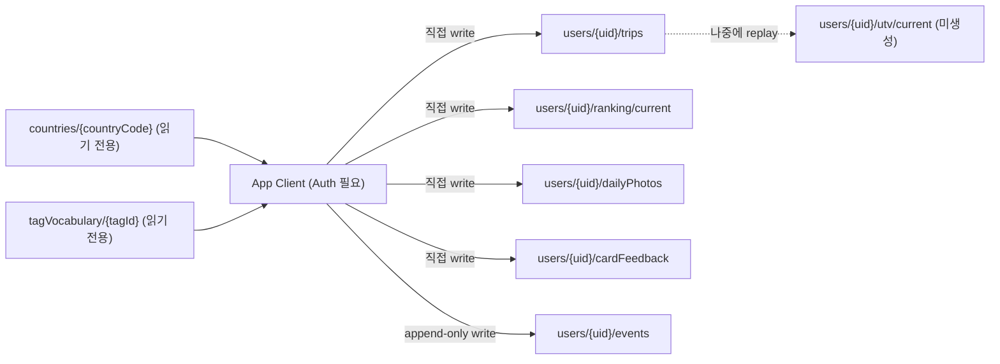

# Firestore 데이터 구조 (앱 직접 쓰기, MVP)

전제: [3.0 스펙](../../docs/product/Travel_Fingerprint_3.0_Spec.md) 2·3·4절. 앱 클라이언트가 Firebase Auth로
로그인한 뒤 Firestore에 **직접** 읽고 씁니다. 서버(Cloud Functions)는 아직 없습니다.
현재 단계는 **기록만 쌓기** — UTV 재생, 국가 프로필 승격, 추천 스코어링은 나중.

## 0. 핵심 원칙

**진짜 데이터 = 여행 원장(`trips`). UTV·추천 결과는 원장에서 언제든 다시 계산하는 캐시.**

원장 문서는 삭제/전체 덮어쓰기 없이 필드만 채워 나갑니다(등록 → 평가 → 랭킹 조정 순으로
필드가 채워짐). 이 규칙이 깨지면 나중에 원장 재생(spec/02 4절)이 불가능해집니다.



## 1. 전역 컬렉션 (앱은 읽기만)

### `countries/{countryCode}`

Stage 0 편집 동결 프로필([spec/pilot/01](../pilot/01-country-profiles-and-axis-diagnostics.md)) 기준.
`countryCode`는 ISO 3166-1 alpha-2 (예: `JP`, `KR`, `FR`).

```
name: string                  // "Japan"
nameKo: string                 // "일본"
continent: string              // "Asia" | "Europe" | ...
status: "confirmed" | "grey"   // 파일럿 통과 여부. grey는 등록만 가능, UTV 반영 보류
tasteCore: {
  natureUrban: number          // -1.0 ~ 1.0, 확정축
  energyLevel: number          // -1.0 ~ 1.0, 조건부축 (수집만)
  planningStyle: number        // -1.0 ~ 1.0, 조건부축 (수집만)
  socialMode: number           // -1.0 ~ 1.0, 조건부축 (수집만)
  noveltyDistance: number | null  // 별도 산출 전이라 null 허용
}
matchingAxes: string[]         // 지금은 ["natureUrban"] — 추천 매칭에 실제 사용하는 축만
interestTags: {                // 0.0~1.0, Interest Tag Profile. 현재는 food만 편집값 존재
  food: number
  culture: number | null
  history: number | null
  outdoor: number | null
  beach: number | null
  nightlife: number | null
  shopping: number | null
  wellness: number | null
  sportsAndEvents: number | null
}
constraints: {
  cost: number                 // 0.0~1.0, Numbeo 정규화
  climate: number               // 0.0~1.0, World Bank 연평균기온 정규화
}
pilotReviewCosine: number       // 편집 동결 단계는 1.0 (자체 동결 표시, 진검수 아님)
source: "editorial_freeze"
updatedAt: timestamp
```

- `tasteCore`의 4개 조건부축은 **매칭에 안 씀** — `matchingAxes`에 없는 축이라는 뜻.
  값은 그대로 저장해 지문 표시·UTV 수집 계산에 쓴다.
- `status: "grey"` 국가는 지금 30개국 세트엔 없음(전원 PASS). 이후 확장국 대비용 필드.

### `tagVocabulary/{tagId}`

[spec/06](../recommendation/06-tag-vocabulary.md) 기준. `tagId`는 영문 키(`food`, `outdoor`, `energyHigh` 등).

```
labelKo: string                 // UI 노출 카피, 예: "에너지 넘치는 자극"
group: "interest" | "polarity" | "negative"
routing: ("taste" | "constraint" | "quality")[]   // 다중 라우팅 가능 (예: food)
axisSignature: { [axis: string]: number } | null  // taste 라우팅일 때만, -1.0~1.0
polarityPairId: string | null   // 양극 태그 쌍 매칭용, 예: "energyLevel"
isNegative: boolean
constraintTarget: string | null // "seasonFit" | "budgetFit" | "flightFriction" 등
qualityTarget: boolean          // true면 국가 품질 점수 집계 대상
```

**Rules**: 두 컬렉션 모두 `read: if request.auth != null`, `write: if false`
(client SDK 쓰기 차단, 시드는 Firebase 콘솔/Admin SDK로만).

## 2. 유저 스코프 컬렉션 (앱이 쌓는 원장)

```
users/{uid}
  (root document)              // 가벼운 프로필 메타
  trips/{tripId}                // ★ 불변 원장 — 등록+평가를 한 문서에 축적
  ranking/current                // 여행 랭킹 보드 스냅샷 (단일 문서)
  dailyPhotos/{photoId}          // 하루 한 장 (기록용, UTV 미반영)
  cardFeedback/{feedbackId}      // 추천 카드 저장/스킵/싫어요 (추천 기능 붙기 전까지 비어 있음)
  events/{eventId}                // 분석용 append-only 로그
  utv/current                     // 나중에 생성 (지금 단계는 문서 없음)
```

Rules 공통: `request.auth != null && request.auth.uid == uid`인 경우에만 해당 유저 서브트리
read/write. 다른 유저 문서 접근 전면 차단.

### 2.1 `users/{uid}` (루트 문서)

```
createdAt: timestamp
onboardingStatus: "pending" | "photo_scan" | "manual" | "quiz" | "done"
locale: string                  // "ko-KR"
homeCountryCode: string | null  // 추천 비행 출발지 기본값
departureAirportCode: string | null // IATA, 공항 데이터 도입 전 null 허용
dailyPhotoAutoFallbackConsent: boolean | null // 첫 하루 한 장에서 1회 확인
```

취향 벡터·UTV 숫자는 여기 두지 않는다 (캐시는 `utv/current`에만, 지금은 미생성).

### 2.2 `users/{uid}/trips/{tripId}` — 원장 (핵심)

[3.0 스펙](../../docs/product/Travel_Fingerprint_3.0_Spec.md) `trip_started`(2.5절) + `trip_evaluated`(2.2절)를
한 문서로 합친 구조. 여행 1건 = 원장 1행.

```
legs: [{
  countryCode: string
  cities: string[]              // 선택 입력, 매칭에는 안 씀 (Stage 1 재료)
  startDate: string             // ISO8601 date
  endDate: string
  days: number
}]
companion: "alone" | "couple" | "family" | "friends"
purpose: "leisure" | "obligation"
status: "planned" | "active" | "ended" | "evaluated" | "skipped_eval"
coverPhotoStoragePath: string | null  // 여행 대표 사진, 평가와 무관

// 평가 필드 — 등록 시점엔 전부 null, 평가 완료 시에만 update
satisfaction: number | null           // 1~5
wouldRepeat: boolean | null
bestLegCountryCode: string | null     // 구간 2개 이상일 때만
comparison: {
  vsTripId: string | null
  result: "better" | "worse" | "skipped"
} | null
positiveTags: string[]                 // 최대 5개
negativeTags: string[]                 // 최대 3개
tagLegAttribution: { [tag: string]: string } | null   // 다구간 + taste 태그만
evalSource: "post_trip" | "onboarding_backfill" | "manual_backfill" | null
skipped: boolean | null

rankPosition: number | null            // 랭킹 보드 위치, 1=최고. 랭킹 조정 시에만 변경

createdAt: timestamp
startedAt: timestamp | null
endedAt: timestamp | null
evaluatedAt: timestamp | null
updatedAt: timestamp
```

**쓰기 규칙 (지금 단계)**

| 시점 | 변경 필드 |
|---|---|
| 여행 등록 | `legs`, `companion`, `purpose`, `status="planned"`, `createdAt` |
| 여행 시작 감지/수동 | `status="active"`, `startedAt` |
| 종료 | `status="ended"`, `endedAt` |
| 평가 제출 | `satisfaction`, `wouldRepeat`, `bestLegCountryCode`, `comparison`, `positiveTags`, `negativeTags`, `tagLegAttribution`, `evalSource`, `status="evaluated"`, `evaluatedAt` |
| 평가 스킵 | `skipped=true`, `status="skipped_eval"`, `evaluatedAt` |
| 랭킹 조정 | `rankPosition`만 |
| 대표 사진 선택·교체 | `coverPhotoStoragePath`만 |

UTV 축 점수·s̃_t·x_t는 **이 문서에 절대 저장하지 않는다** — 전부 나중에 원장을 읽어 계산.

Rules: `create`는 `legs`가 비어있지 않고 `status == "planned"`일 때만 허용.
`update`는 평가·상태·대표 사진 관련 필드만 변경 허용, `legs`/`createdAt`은 생성 후 불변으로 막는다
(원장 변조 방지, 상세 규칙은 3절).

### 2.3 `users/{uid}/ranking/current` (단일 문서)

```
tripIdsOrdered: string[]        // 1위 -> 꼴찌
ledgerVersion: number           // 조정 시마다 +1
updatedAt: timestamp
```

보드 화면이 정렬 배열 하나만 읽으면 되도록 하는 캐시. `trips.rankPosition`과 값이 겹치는데,
불일치 시 **이 문서를 기준**으로 삼고 `trips.rankPosition`은 표시용 미러로 취급.

### 2.4 `users/{uid}/dailyPhotos/{photoId}`

```
tripId: string
tripDayIndex: number
storagePath: string             // Firebase Storage 유저 전용 경로
selection: "manual" | "auto_fallback"
dayReaction: "good" | "neutral" | "bad" | null
createdAt: timestamp
```

[3.0 스펙 2.5절 경계 규칙](../../docs/product/Travel_Fingerprint_3.0_Spec.md) 그대로: **UTV·Profile_x 계산에
절대 사용하지 않음.** 회고 배경·Wrapped 재료로만 읽는다.

사진 바이너리는 Firestore가 아니라
`users/{uid}/trips/{tripId}/daily/{photoId}.jpg` 경로의 Firebase Storage에 화면용
리사이즈본으로 저장합니다. 업로드 전 EXIF 위치 메타데이터를 제거하며 원본은 저장하지
않습니다. Storage Rules는 인증된 본인의 `{uid}` 경로만 읽기·쓰기를 허용합니다.

### 2.5 `users/{uid}/cardFeedback/{feedbackId}`

추천 기능이 아직 없으므로 지금 단계에서는 컬렉션만 정의해 두고 실제 쓰기는 없음.

```
countryCode: string
slot: "best_match" | "fresh_stretch" | "underrated_fit"
action: "save" | "skip" | "dislike"
reason: "too_expensive" | "too_far" | "safety" | "not_my_taste" | null
excludeUntil: timestamp | null  // dislike면 createdAt + 180일
revokedAt: timestamp | null     // 유저가 제외 목록에서 해제한 시점
createdAt: timestamp
```

- `skip`: 현재 카드 교체만 수행하며 추천 점수와 재노출 확률을 변경하지 않습니다.
- `dislike`: `excludeUntil`까지 일반 후보에서 제외하고 이후에도 강한 감점을 유지합니다.
  유저가 설정에서 해제하면 `revokedAt`을 기록합니다.

### 2.6 `users/{uid}/events/{eventId}` — append-only 분석 로그

원장과 별도로 KPI용 이벤트를 그대로 남긴다. [spec/05](../analytics/05-kpi-and-events.md) 이벤트 타입과 1:1.

```
type: "trip_started" | "trip_evaluated" | "ranking_adjusted" | "daily_photo_selected"
      | "recommendation_feedback" | "wrapped_opened" | "wrapped_completed"
      | "wrapped_image_saved" | "wrapped_shared" | "trip_card_shared"
payload: object                 // 해당 이벤트의 스펙 필드 그대로
createdAt: timestamp
```

Rules: `create`만 허용, `update`/`delete` 전면 차단.

### 2.7 `users/{uid}/utv/current` — 지금 단계는 생성하지 않음

나중에 원장 재생(replay) 결과가 들어갈 캐시. 참고용으로 예상 형태만 기록:

```
tasteCore: { natureUrban, energyLevel, planningStyle, socialMode, noveltyAppetite }
axisConfidence: { [axis: string]: number }
ledgerVersion: number
recomputedAt: timestamp
```

## 3. Security Rules 초안

전체 파일은 [`firebase/firestore.rules`](../../firebase/firestore.rules) 참고. 핵심 규칙:

- 전역(`countries`, `tagVocabulary`): 로그인 유저 읽기 전용, 클라이언트 쓰기 전면 차단
- `users/{uid}/**`: 본인만 읽기/쓰기
- `trips`: 생성 시 `legs` 비어있지 않음 + `status == "planned"` 필수, 수정 시 `legs`/`createdAt` 불변
- `events`: 생성만 허용, 수정·삭제 차단
- `utv`: 지금 단계는 문서가 없으므로 규칙에서도 쓰기 차단(전부 `false`) — 나중에 재생 로직 붙을 때 재검토

## 4. 지금 하지 않는 것

- Cloud Functions / UTV 원장 재생
- `countries`/`tagVocabulary` 클라이언트 쓰기, 태그 리프트 집계
- 추천 스코어링, `cardFeedback` 실제 발생
- 복합 색인(composite index) — 현재 쿼리는 전부 `uid` 서브컬렉션 단순 읽기라 불필요

## 5. 시드 데이터

- `countries` 30개국 시드: [spec/../pilot/data/seed/countries.json](../pilot/data/seed/countries.json)
  (`country_profiles_draft.csv` 기반, 0~1 스케일을 -1~1로 변환)
- `tagVocabulary` 시드: [spec/../pilot/data/seed/tagVocabulary.json](../pilot/data/seed/tagVocabulary.json)
  ([spec/06](../recommendation/06-tag-vocabulary.md) 기준, 검수 전 초안)
- 두 시드 모두 Firebase 콘솔 가져오기 또는 Admin SDK 스크립트로 넣는다. 앱 코드에서 쓰기 금지.
