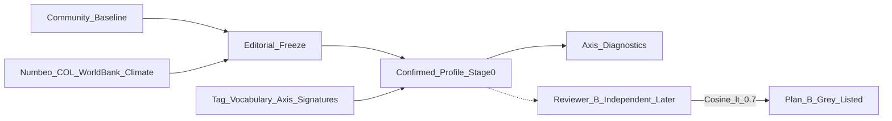

# 30개국 파일럿 — 국가 프로필 라벨링 · 2인 검수 · 축 진단 (3.0)

상태: **편집 프로필 1차 동결** (커뮤 검수 축 + Numbeo/기후 공개데이터).  
진짜 2인 독립 검수·실사용 유저 데이터(필터2)는 아직 미투입.

3.0 개편으로 이 파일럿의 무게가 더 커졌습니다: MVP에서 Profile_x는 **편집 동결**이고
e_t가 방문국 프로필에서 파생되므로([3.0 스펙](../../docs/product/Travel_Fingerprint_3.0_Spec.md) 3절),
**편집 프로필의 품질이 곧 추천 품질**입니다 (리스크 레지스터 #1).

## 1. 대상 국가 (30개국, 대륙 균형 — 기존 유지)

| 대륙 | 국가 수 | 국가 |
|---|---|---|
| Asia | 6 | Japan, Thailand, Vietnam, India, South Korea, Indonesia |
| Europe | 6 | France, Italy, Iceland, Portugal, Norway, Greece |
| Africa | 5 | Morocco, Kenya, South Africa, Egypt, Tanzania |
| North America | 4 | USA, Mexico, Canada, Costa Rica |
| South America | 4 | Peru, Brazil, Argentina, Colombia |
| Oceania | 3 | New Zealand, Australia, Fiji |
| Middle East | 2 | UAE, Jordan |

최종 리스트는 콘텐츠팀 확정 필요 (관광 수요, 데이터 가용성).

## 2. 파이프라인과 검수 대상 (3.0 개정)



검수 대상 (3.0에서 확장):

1. **Taste Core Profile**: `nature_urban`, `energy_level`, `planning_style`, `social_mode`
   (매칭 4축, 코사인 합치도 0.7 판정 대상) + `novelty_distance`(공개데이터 보조)
2. **Interest Tag Profile**: `food` 등 9개 태그별 점수 (합치도 판정에는 미포함)
3. **태그 어휘 축 서명** ([spec/06](../recommendation/06-tag-vocabulary.md)): **신규 검수 대상.**
   태그→축 매핑이 UTV와 Profile_x 양쪽으로 전파되므로(리스크 #2) 국가 프로필과
   같은 게이트를 통과해야 함
4. Constraint Profile은 공개데이터 자동 채움 — 검수 불필요 (기존 유지)

통과 기준 4종(축 분산 / 유저 분산 / 설명 품질 / 검수 재현성)과 탈락국 플랜B
(회색 처리 → 점진 승격)는 2.0 정의 유지.

## 3. 실행 스크립트

[scripts/generate_pilot_diagnostics.py](scripts/generate_pilot_diagnostics.py)

- 축 이름이 3.0 체계로 통일됨 (`energy_level`, `planning_style`, `social_mode`).
- `EDITORIAL_FREEZE=True`: 편집 확정값을 노이즈 없이 CSV에 기록. 실검수 시 False로 전환.
- Taste 축 소스: [data/country_profiles_baseline_community.csv](data/country_profiles_baseline_community.csv)
- cost/climate: Numbeo COL 2025 + World Bank 연평균기온(관광 코리더 보정)
- 산출물: [data/country_profiles_draft.csv](data/country_profiles_draft.csv),
  [01-country-profiles-and-axis-diagnostics.generated.md](01-country-profiles-and-axis-diagnostics.generated.md)

```bash
python3 spec/pilot/scripts/generate_pilot_diagnostics.py
```

## 4. 편집 동결 결과 요약 (재검증: 2인 독립 검수 후)

- 30개국 편집값 동결. 합치도 1.0은 자체 동결 표시(독립 검수 전).
- LLM 초안에서 뒤집혀 있던 `social_mode` 극성(아이슬란드·노르웨이 등이 "북적"으로 나오던 문제)과
  사파리국 `planning_style`(케냐·탄자니아)을 커뮤 검수·여행 관행 기준으로 교정.
- 조건부 3축 진단 (임계값: 국가분산 0.030, 독립성 |r|<0.60 — 둘 다 확정 필요):

| 축 | 국가분산 | 필터1 | 최대 상관 | 독립성 | 국가측 종합 |
|---|---|---|---|---|---|
| energy_level | 0.0173 | FAIL | +0.702 (social_mode) | FAIL | **FAIL** |
| planning_style | 0.0170 | FAIL | -0.577 (social_mode) | PASS | **FAIL** |
| social_mode | 0.0112 | FAIL | +0.702 (energy_level) | FAIL | **FAIL** |

해석: 편집값 기준으로는 조건부 3축 모두 국가분산이 임계 미달이고,
energy↔social이 강하게 묶입니다(활기 있는 나라 = 사람 많은 경험).
기존 규칙대로 UTV/Wrapped 수집은 유지하고, 매칭 편입은 필터2(유저분산)와
태그 어휘 양극 선택률을 본 뒤 결정.

## 5. 필터2 (유저분산) — 측정 대상 변경 (3.0)

- **(구) 측정 대상**: 여행 종료 회고 슬라이더의 축 값 → 입력 폐기로 무효.
- **(신) 측정 대상**: `trip_evaluated` 기반 축 추정치 — 같은 국가를 방문한 유저들의
  x_t 태그 보정치(정확히는 태그 서명 경유 축 신호, [spec/02](../signal/02-signal-quality-and-aggregation.md) 3절)의 유저 간 분산.
- **주의 (리스크 #3 연동)**: 양극 태그 선택률이 낮으면 축별 결측이 커져 필터2가
  "축이 나빠서"가 아니라 "계측이 약해서" 실패할 수 있음. 판정 전에 성향 태그 선택률
  (spec/05 지표)을 함께 볼 것.
- 최소 표본 조건(제안): 국가당 유저 20명, 축당 결측률 30% 이하. (확정 필요)
- 트리거: Stage0 배포 후 4~6주 또는 표본 조건 충족 중 늦은 시점.

## 6. 확정이 필요한 항목

- 국가분산 임계값(0.030), 독립성 한계(|r|<0.60) 최종값
- 필터2 최소 표본 조건
- 30개국 최종 리스트, 진짜 2인 검수자 배정
- 태그 어휘 축 서명 검수 절차의 합치도 판정 방식 (국가 프로필과 동일한 코사인 방식 vs 축별 허용 오차)
