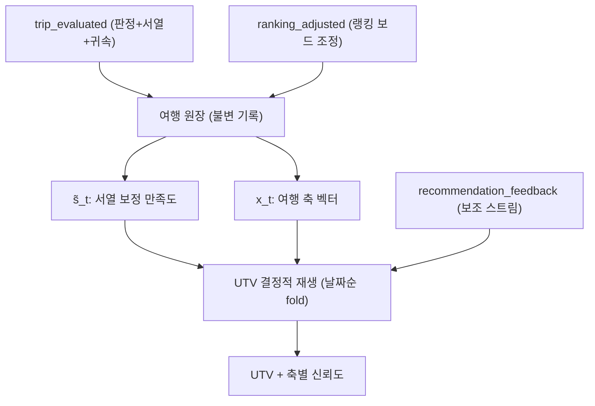

# 평가 신호 모델 — s̃_t 캘리브레이션, x_t 계산, UTV 재생 규칙

전제: [3.0 스펙](../../docs/product/Travel_Fingerprint_3.0_Spec.md) 2절(입력)·4절(UTV).
구버전(여행 중 다회 슬라이더의 q_event/Q_t 품질가중 모델)은 입력 메커니즘 폐기와 함께
전면 대체되었습니다. 이 문서는 "여행 평가 하나를 어떻게 신뢰할 수 있는 UTV 업데이트로
바꾸는지"를 정의합니다.

## 1. 전체 파이프라인



핵심 설계: UTV는 증분 누적 상태가 아니라 **원장에서 언제든 재계산 가능한 파생값**입니다.
랭킹 수정 = 과거 라벨 교정 → 재생으로 반영. 수정이 잦을수록 라벨 품질이 올라갑니다.

## 2. s̃_t — 서열 보정 만족도

절대 만족도(1~5)는 유저 간 스케일이 달라 그대로 쓰지 않습니다.

```
rank_pct_t = 1 - (rank_t - 1) / max(1, N_trips - 1)     # 1위=1.0, 꼴찌=0.0
s̃_t = w_rank * rank_pct_t + (1 - w_rank) * (satisfaction_t - 1) / 4
```

- `w_rank` 제안값 0.7 (서열 우선). 여행 2개 이하로 랭킹이 무의미하면 w_rank=0
  (절대값 폴백, 신뢰도 하향 플래그).
- **서열 비교 앵커는 동적 선택** (3.0 스펙 2.2절): 같은 만족도 점수대 · 비의무 여행 ·
  최근 순 → 인접 점수대 → 직전 여가 여행 폴백. 같은 점수대 내부를 가르는 비교라
  랭킹 삽입(이진 탐색) 관점에서 원탭 1회의 정보량이 최대.
- 서열 비교를 스킵한 여행: 만족도 절대값으로 랭킹에 임시 삽입, 유저가 보드에서 조정 가능.
- 평가 전체를 스킵한 여행: s̃_t = 유저 중앙값(0.5), 해당 여행의 반영 상한을 절반으로.

## 3. x_t — 여행의 축 벡터 (다구간 지원)

```
w_i  = days_i / Σ days                      # 구간별 체류일 비중
       bestLeg이면 w_i × 1.5 후 전체 재정규화
base = Σ_i w_i · Profile_구간i(TasteCore 5축)
x_t  = base + Σ_{tag ∈ positiveTags, taste 라우팅} sig(tag) * α_pos
       (부정 태그는 4.2 축별 게인에서 방향 반전으로 처리, x_t 자체는 보정하지 않음)
clamp(x_t, -1, 1)
```

- 단일 구간 여행이면 기존 식(`x_t = Profile_방문국 + 태그 보정`)과 동일.
- **태그 나라 귀속** (3.0 스펙 2.2절, `tagLegAttribution`): 귀속된 taste 태그의
  `sig(tag)·α_pos` 항은 x_t 전체가 아니라 **해당 구간의 w_i·Profile_구간i 기여분에만** 가산
  (구간 벡터를 태그 방향으로 보정한 뒤 합산) — Attribution Blur(리스크 #9) 방지.
  귀속 없는 태그는 기존 규칙: 긍정 태그를 베스트 구간에 가중 배분.
- 프로필 미확정(회색) 구간은 base 가중 평균에서 제외하고 w 재정규화.
  전 구간이 회색이면 그 여행은 원장 기록만, UTV 반영 보류 (프로필 승격 시 재생으로 소급 반영 — 원장 재생 구조의 이점).
- `sig(tag)`: [spec/06](../recommendation/06-tag-vocabulary.md)의 축 서명 벡터.
- `α_pos` 제안값 0.3 — 태그가 국가 기본값을 "개인의 경험 방향"으로 당기는 강도.
- 태그를 하나도 안 고른 여행: x_t = base 그대로 (n=0 케이스).
- 도시 입력은 MVP에서 x_t에 사용하지 않음 — 원장 축적 전용 (Stage 1 재료).
- v1.5에서 스토리(순간기록)가 들어오면 x_t에 순간 태그 항이 n/(n+k′) 블렌드로 추가될
  뿐, 이 식의 구조는 바뀌지 않습니다.
- constraint/quality 라우팅 태그는 x_t에 반영하지 않고 각각 Constraints 개인값,
  국가 품질 집계로만 전달합니다.

## 4. UTV 재생

### 4.1 기본 fold (날짜순)

```
for trip t in ledger (오름차순):
    UTV[a] ← UTV[a] + λ_t * g_a(t) * (x_t[a] - UTV[a])    # 축 a마다
    UTV[a] ← clamp(UTV[a], 이전값 ± δ_step)                 # 여행 1회 스텝 상한
```

- 초기값 UTV_0: 온보딩 폴백(사진 A/B 선택 퀴즈, spec/09) 결과 또는 0벡터.
- `δ_step` 제안값 0.25.

### 4.2 축별 게인 g_a

```
base = g(s̃_t) = clamp(2.6 * s̃_t - 1.3, -0.3, 1.0)         # 선형 초안, 실험으로 곡선 확정

축 a에 대해:
  a가 긍정 태그의 서명에 포함  → g_a = max(base, 0) * 1.5   (상한 1.0)
  a가 부정 태그의 서명에 포함  → g_a = -0.5                  (그 축 값에서 밀어내기)
  둘 다 아님                   → g_a = base * 0.5            (약한 기본 이동)

컨텍스트 보정 (trip_started의 사실 필드):
  여행 성격 = 의무(출장·행사)        → 전 축 g_a × 0.2      (원장 기록만, 취향 거의 미반영)
  동행 정보와 일치하는 상황성 태그    → 해당 축 g_a × 0.5
    (예: '혼자' 여행에서 '혼자만의 시간' 태그 → socialMode 게인 절반 —
     취향인지 상황인지 구분 불가하므로 보수적으로. '가족' 여행인데 같은 태그면 강한 취향 신호 → 보정 없음)
```

같은 여행에서 축마다 부호가 다를 수 있습니다 — "여행은 최고였는데 북적임만 싫었다"가
socialMode만 음성으로 표현됩니다.

### 4.3 λ 스케줄 (기존 유지)

- 여행 수 9회부터, 또는 유효 신호(평가 3회+카드 10회 / 평가 5회 단독) 도달 시 λ_min≈0.1.
- 그 전에는 λ_t = 1/(t+1) 형태의 감쇠 (기존 설계 유지).

### 4.4 축별 신뢰도 c_a (+ Staleness 할인)

```
c_a = n_a / (n_a + k_axis) · decay_a          # n_a: 축 a를 명시적으로 건드린 태그·비교 수, k_axis 제안값 4
decay_a = max(f_min, 0.5 ^ (months_since_last_signal_a / τ_stale))
          # τ_stale 제안값 24개월, 하한 f_min 제안값 0.4
```

- 매칭 시 tasteFit 계산에서 축별 가중치에 곱해짐 (신뢰도 낮은 축은 기여 축소 = 인구
  사전값으로의 수축과 동치).
- **decay_a는 신호 공백(staleness) 방어**: 원장 재생의 EMA는 "뒤늦게 추가된 옛 여행"은
  자동 희석하지만, "최근 여행이 아예 없는" 유저의 취향 표류는 못 잡음 → 마지막 신호가
  오래된 축은 확신을 낮춤. **UTV 값(게인)에는 시간 감가를 걸지 않음** — 온보딩 백필이
  전부 과거 여행이므로 게인 감가는 콜드스타트와 충돌 (3.0 스펙 4.3절). 하한 f_min이
  그 안전판.
- UI 지문에 "데이터 적은 축" 표시의 근거값.
- **온보딩 확장 — 간접 신호 가산**: n_a는 태그·비교만 세므로, 태그를 받지 않는 온보딩
  백필에서는 여행을 아무리 등록해도 모든 축이 n_a≈0이 되는 사각지대가 있음 (등록이
  국가 프로필 경유로 주는 간접 축 정보가 미계상). 온보딩 퀴즈 게이트([spec/09](../ui/09-taste-quiz.md))
  용도로는 등록 여행 1개당 축별 변별력 가중 `v_a`를 부분 가산:
  `n_a = Σ v_a + 태그·비교 수`. v_a는 파일럿 축 분산에서 도출 (제안 초안: natureUrban
  1.0, planningStyle 0.7, noveltyAppetite 0.3, energyLevel·socialMode 0.2 — 국가분산
  FAIL 축은 등록만으로 신뢰도가 오르지 않게). 값은 파일럿 실측 후 확정, 원격 설정 분리.

### 4.5 카드 반응 보조 스트림

`recommendation_feedback`은 원장 밖의 보조 스트림입니다. `save`와 `dislike`만 가중치
0.4의 저강도 업데이트로 UTV에 반영하고, `skip`은 현재 카드 교체 동작일 뿐 UTV·탐험 반경·
재노출 확률에 반영하지 않습니다. `dislike`는 해당 국가 프로필 방향의 음성 게인이며 180일
후보 제외와 이후 강한 감점을 함께 적용합니다.

## 5. 재생 트리거와 디바운스

| 트리거 | 처리 |
|---|---|
| `trip_evaluated` 확정 | 즉시 재생 → 지문 델타 + 추천 1슬롯 갱신 (체감 루프) |
| 랭킹 보드 조정 | 편집 세션 종료 시 1회 재생 (디바운스) → "랭킹 조정으로 지문이 변했어요" 델타 |
| 온보딩 과거 등록 | 등록 완료 시 일괄 재생 → 첫 지문 생성 |

재생마다 `utv_recomputed` 이벤트(전후 델타, 트리거)를 남깁니다 — 파라미터 수렴 관측용
(리스크 #5), [spec/05](../analytics/05-kpi-and-events.md).

## 6. 데이터 스키마 영향

- **여행 원장 테이블(불변)**: `trip_id, user_id, companion, purpose(leisure|obligation),
  satisfaction, would_repeat, best_leg_country, comparison_result, positive_tags[],
  negative_tags[], tag_leg_attribution{태그: country_code}(선택), rank_position, source, skipped`
- **구간 테이블**: `leg_id, trip_id, country_code, cities[](선택), start_date, end_date`
  — 도시는 MVP에서 축적 전용, Stage 1 지역 확장 재료
- **UTV 캐시**: `user_id, axes{5}, confidence{5}, last_replayed_at, ledger_version`
- 랭킹 조정은 여행 원장의 평가 필드를 덮어쓰지 않고 Firestore
  `users/{uid}/ranking/current` 스냅샷으로 관리합니다. 저장된 변경 이력은 append-only
  `ranking_adjusted` 이벤트에 남기며, `trips.rankPosition`은 표시용 미러입니다.

## 7. 확정이 필요한 값 (전부 원격 설정으로 분리)

- `w_rank`(0.7), `α_pos`(0.3), `δ_step`(0.25), `k_axis`(4), g 곡선(선형 초안 → 실험 A′),
  긍정/부정 게인 배율(1.5 / -0.5), 카드 반응 가중치(0.4), 스킵 여행 반영 상한(50%),
  `τ_stale`(24개월) · `f_min`(0.4) — staleness 할인(4.4)
