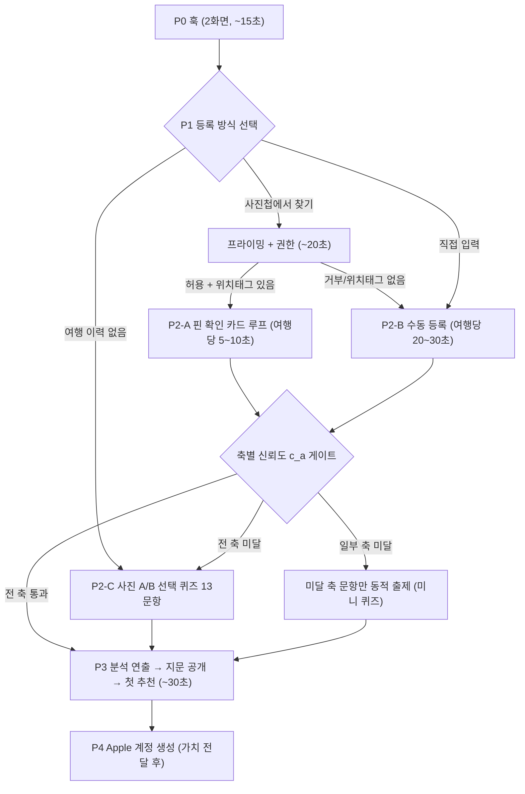

# 온보딩 UI 플로우 — Rise 스타일 설문 구조 (초안)

전제: [3.0 스펙](../../docs/product/Travel_Fingerprint_3.0_Spec.md) 2.1절(과거 여행 등록)의 UI 구체화.
데이터 스키마·폴백 구조는 2.1절을 그대로 따르고, 이 문서는 **화면 순서, 연출, 카피 방향,
권한 요청 타이밍**만 정의합니다.

## 0. 설계 원칙 — Rise에서 가져올 것과 버릴 것

RISE(수면 앱)의 온보딩은 30단계 이상의 설문인데도 완료율이 높은 사례로,
핵심은 "온보딩 모멘텀"입니다: 훅 → 쉬운 질문 → 점진적 심화 → 권한 요청 → 분석 연출 → 개인화 결과 공개.

| Rise 패턴 | 채택 여부 | 우리 적용 |
|---|---|---|
| 호기심 훅 먼저, 질문은 나중 | 채택 | P0 훅 화면 — "Welcome" 금지, 가치 선언으로 시작 |
| 한 화면 = 한 질문 | 채택 | 여행 1개 = 카드 1장, 원탭 1회 |
| 쉬운 질문 → 어려운 질문 순서 | 채택 | 만족도 원탭(쉬움) 먼저, 서열 비교(어려움) 나중 |
| 질문마다 "왜 묻는지" 맥락 제공 | 채택 | 3~5개 여행마다 컨텍스트 팝업 1회 (매 화면 금지 — 예산 초과) |
| 권한 요청은 모멘텀 쌓인 뒤 + 이유 설명 | 채택 | 사진첩 방식 선택 후(P1) / 알림(P3, 결과 확인 후) 분리 |
| "분석 중" 연출 화면 | 채택 | P3 "지문을 그리는 중" — 스캔 연출과 별도 1회 |
| 가치 전달 후 계정 생성 | 채택 | 계정 생성은 첫 추천 확인 **이후** |
| 30~47단계 설문 길이 | **버림** | 총 예산 2~3분 사수 (2.1절). 리듬만 빌리고 길이는 안 빌림 |
| 하드 페이월·다크 패턴 | **버림** | 모든 스텝 스킵 가능, 뒤로가기 허용, 압박 카피 금지 |

## 1. 플로우 개요

**퀴즈 분기 기준 — 여행 수 고정이 아니라 축별 신뢰도 게이트** (별도 질문 화면 없음,
등록 완료 시점에 자동 계산): `c_a < 0.4`인 축의 문항만 동적 출제. 수식과 온보딩 확장
(등록 여행의 국가 경유 간접 신호 가산)은 [spec/09](09-taste-quiz.md) 1절·[spec/02](../signal/02-signal-quality-and-aggregation.md) 4.4절.
여행 수 기준의 예상 동작(근사): 0~2개 ≈ 풀 퀴즈 13문항, ~5개 ≈ 국가분산 FAIL 축
(energyLevel·socialMode)만 남아 미니 퀴즈 3문항, 그 이상 ≈ 퀴즈 생략.

## 2. 화면별 정의

### P0 — 훅 (2화면 고정, 추가 금지)

| # | 화면 | 내용 |
|---|---|---|
| P0-1 | 훅 | 카피 방향: "지금까지의 여행이, 다음 여행지를 알고 있어요." 인사말·앱 소개 문단 금지. 배경에 여행 지문 시각화가 그려지는 모션 |
| P0-2 | 기대 설정 | 예시 지문 + "몇 번의 탭이면 당신의 지문이 나옵니다 (약 2분)". 소요 시간을 미리 약속 — 이 약속이 뒤 스텝의 이탈 방어 |

### P1 — 등록 방식 선택과 조건부 사진 권한

| # | 화면 | 내용 |
|---|---|---|
| P1-1 | 방식 선택 | `사진첩에서 자동으로 찾기` / `직접 입력하기`를 동등한 카드로 노출. `사진 퀴즈로 시작`도 제공 |
| P1-2 | 사진첩 가치 제안 | 사진첩 방식을 고른 경우에만 "다녀온 곳을 지도에서 찾아드릴까요?" + 지도 핀 프리뷰. **경계 문구 필수**: "사진 위치는 기기 안에서만 분석되고, 서버로 전송되지 않아요" |
| P1-3 | 시스템 권한 | 사진첩 방식에서만 iOS 사진 권한 요청. 거부 시 즉시 P2-B로, 재요청 넛지 금지 |
| P1-4 | 스캔 연출 | 온-디바이스 군집화 진행을 지도 핀 애니메이션으로 표시. 다국가 군집은 여행 1건의 복수 구간으로 제안 |

### P2-A — 핀 확인 카드 루프 (사진첩 선택 경로)

- 카드 1장 = 여행 1개. 국가+시기 EXIF 자동 완성, 유저는 **만족도 원탭(1~5)만**.
- 카드 하단에 진행 표시 (예: "3 / 8"). Rise의 한-화면-한-질문 리듬.
- **서열 비교 끼워넣기**: 등록 2개째부터, 만족도 원탭 직후 같은 카드에서
  "예전 {앵커}보다 좋았나요?" 원탭 1개 (2.2절 동적 앵커 규칙). 쉬운 질문 → 비교 질문 순서.
- **컨텍스트 팝업**: 3번째 카드에서 1회만 — "만족도만 묻는 이유: 나라 설명은 저희가 알아요.
  당신만 아는 건 '얼마나 좋았는지'뿐이에요" (스펙 0절 원칙의 유저용 번역).
- 카드마다 "이 여행 아니에요" (핀 오탐 제거) + "나머지는 나중에" (조기 종료 → P3 진입.
  3개 이상 등록 시 활성화) 항상 노출.
- 귀속 태그는 온보딩에서 **묻지 않음** — 여행당 5~10초 예산 사수. 태그는 랭킹 보드/다음 평가에서.

### P2-B — 수동 등록 (폴백)

- 국가 검색 → 대략적 시기 → 만족도 원탭 → (선택) 긍정 태그 ≤3.
- 한 화면에서 여행 1개 완결, "여행 추가" 반복. 3개 등록 시 "지문 보러 가기" 활성화.
- 태그 노출은 [spec/06](../recommendation/06-tag-vocabulary.md) 규칙 축소판 (관심사 그룹만, 성향 그룹 제외 —
  온보딩에서 성향 태그는 인지 부하 대비 정보량 낮음).

### P2-C — 사진 A/B 선택 퀴즈 (여행 이력 없는 유저)

- "어느 쪽이 더 끌리나요?" 사진 탭(클릭) 선택 — 스와이프 제스처 없음.
- Rise의 퀴즈 감성과 가장 유사한 구간 — 진행 바 + 즉각 피드백 모션.
- 결과 UTV에 신뢰도 하향 플래그 (2.1절). 결과 화면 카피도 "첫인상 지문"으로 구분.
- **구체 문항 세트·서명·점수화 규칙은 [spec/09](09-taste-quiz.md)** — 축별 A/B 12문항 +
  2×2 쿼드런트 1문항 + 관심사 칩 1문항 (13문항, 퀴즈만으로 첫 추천 3슬롯 도달).

### P3 — 분석 연출 → 페이오프 (Rise의 "Synthesizing insights" + 결과 공개)

| # | 화면 | 내용 |
|---|---|---|
| P3-1 | 지문 합성 연출 | 단계 텍스트가 순차 표시: "여행 8개 분석 중 → 취향 축 계산 중 → {N}개국과 대조 중". 실제 재생(replay) 실행 시간과 무관하게 2~4초 고정 연출. 투명성 연출이지 가짜 로딩 아님 — 표시 문구는 실제 파이프라인 단계와 일치시킬 것 |
| P3-2 | 지문 공개 | Taste Core 시각화 + 데이터 적은 축은 "아직 흐린 축"으로 정직 표기 (4.3절). "여행을 평가할수록 선명해져요" |
| P3-3 | 첫 추천 3슬롯 | best_match / fresh_stretch / underrated_fit. 설명은 태그 언어 (spec/04). **여기가 온보딩의 페이오프** — Rise의 "당신의 수면 필요량" 공개에 해당 |

### P4 — 가치 전달 후 요청

- P4-1 계정 생성: 지문·추천을 이미 본 뒤 Apple 로그인 필수. Google·게스트 모드는 제공하지 않음.
- 알림의 가치는 이 단계에서 짧게 설명할 수 있지만 시스템 알림 권한은 요청하지 않습니다.
  실제 요청은 첫 예정·현재 여행 등록 완료 직후(UI-6C-5)에만 수행합니다.

## 3. 시간 예산

| 구간 | 예산 |
|---|---|
| P0 훅 | ~15초 |
| P1 프라이밍+권한+스캔 | ~20초 |
| P2-A 여행 5개 기준 | 25~50초 |
| P3 연출+지문+추천 | ~30초 |
| P4 계정 | ~20초 |
| **합계** | **약 2분** (2.1절 2~3분 예산 내) |

P2-B 폴백은 여행당 20~30초라 5개 등록 시 상한 3분 초과 가능 → 3개 등록 시점부터
"지문 보러 가기" CTA를 상단 고정해 조기 페이오프 허용.

## 4. 다크 패턴 금지 목록 (Rise 반면교사)

- 하드 페이월 없음 — P3 페이오프는 무조건 무료로 도달.
- 권한 거부 시 재요청 루프·죄책감 카피 금지 (2.6절 압박 장치 금지 원칙의 온보딩 확장).
- 뒤로가기·스킵을 숨기지 않음. "나머지는 나중에"는 모든 P2 화면에 상시 노출.
- 가짜 소셜 프루프·카운트다운 금지.

## 5. 계측

- `trip_evaluated(source=onboarding_backfill)` — 기존 스키마 그대로 (spec/05).
- 신규 퍼널 이벤트: `onboarding_step_completed { step: "P0-1" | ... , elapsed_ms }` —
  화면별 이탈률 측정. spec/05 이벤트 표에 병합 필요.
- 핵심 퍼널 지표: 사진첩 권한 수락률(P1-2), 여행당 평균 등록 시간(P2), 등록 여행 수 분포,
  P3-3 도달률, P3-3 → 저장 전환율.

## 6. 확정이 필요한 항목

- 훅 카피 최종안 (P0-1) — UX 라이팅
- 지문 시각화 형태 (레이더 vs 지문 모티프 커스텀) — P0-2·P3-2 공용
- P2-C 사진 세트 제작 (3.0 스펙 11절 미결 승계)
- P3-1 연출 고정 시간 (2~4초 범위 내 실측 튜닝)
