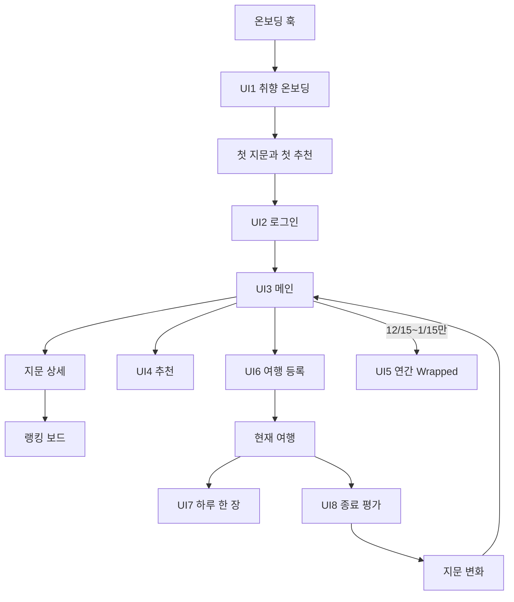

# Travel Fingerprint UI 상세 구조

이 폴더는 [최종 스펙](../../../docs/product/Travel_Fingerprint_3.0_Final_Spec.md)과
[모델 본문](../../../docs/product/Travel_Fingerprint_3.0_Spec.md)을 실제 화면 단위로 풀어 쓴
고정본입니다. 각 문서는 **메인 UI → 서브 UI → 상태/분기 → 데이터 → 완료 조건** 순서로
정리합니다. 제품·UI 충돌 시 Final Spec이 우선합니다.

## UI 영역

| ID | 영역 | 핵심 목적 | 문서 |
|---|---|---|---|
| UI-1 | 취향 온보딩 | 과거 여행 또는 13문항으로 첫 지문 생성 | [UI-01](UI-01-taste-onboarding.md) |
| UI-2 | 로그인 | 첫 가치 확인 후 계정 생성·복구 | [UI-02](UI-02-login.md) |
| UI-3 | 메인·지문·랭킹 | 현재 상태와 다음 행동을 한곳에서 연결 | [UI-03](UI-03-home-fingerprint-ranking.md) |
| UI-4 | 여행지 추천 | 3슬롯 추천 탐색·피드백 | [UI-04](UI-04-recommendations.md) |
| UI-5 | Wrapped | 연간 여행 취향 요약 이미지 생성·공유 | [UI-05](UI-05-wrapped.md) |
| UI-6 | 여행 등록 | 과거·예정·현재 여행을 원장에 등록 | [UI-06](UI-06-trip-registration.md) |
| UI-7 | 하루 한 장 | 여행 중 대표 사진과 선택 반응 기록 | [UI-07](UI-07-daily-photo.md) |
| UI-8 | 여행 종료 평가 | 판정·서열·귀속을 30초 안에 수집 | [UI-08](UI-08-trip-evaluation.md) |

## 전체 내비게이션

## 공통 UI 원칙

- 한 화면의 주 CTA는 하나만 둡니다.
- 입력 화면은 뒤로가기와 건너뛰기를 숨기지 않습니다.
- 취향 입력은 여행 중에 묻지 않습니다. UI-7은 기록용이며 UTV에 반영하지 않습니다.
- `energyLevel`, `planningStyle`, `socialMode`는 지문에 표시·수집하되 현재 추천 매칭에는 쓰지 않습니다.
- 색상과 컴포넌트 기준은 [spec/08](../08-ui-prompts.md)의 다크 테마를 기본으로 합니다.
- 시스템 권한 다이얼로그 전에 반드시 권한을 쓰는 이유와 데이터 경계를 설명합니다.
- 빈 상태는 막힌 화면이 아니라 다음 행동 CTA를 제공합니다.

## 공통 하단 탭 제안

MVP의 기본 탭은 세 개로 고정합니다.

1. **홈** — 지문 요약, 현재 여행, 평가 대기
2. **추천** — 3슬롯 추천과 저장 목록
3. **여행** — 예정·현재·과거 여행과 등록

`랭킹 보드`는 지문 상세에서 진입합니다. 연간 `Wrapped`는 12월 15일~다음 해 1월 15일에만
홈에 노출하고, 개별 여행 공유는 여행 상세에서 연중 제공합니다. 설정·계정은 홈 상단 프로필
메뉴에서 진입합니다.

## 화면 상태 표기

각 문서에서 다음 상태를 공통으로 확인합니다.

- `loading`: 실제 데이터 처리 중
- `empty`: 필요한 기록이 아직 없음
- `partial`: 일부 데이터만 있어 낮은 신뢰도로 표시
- `ready`: 정상 화면
- `offline`: Firestore 로컬 캐시 사용, 동기화 대기 표시
- `error`: 복구 CTA와 안전한 재시도 제공

## 확정 사항

1. 하단 탭은 `홈 / 추천 / 여행` 3개로 고정합니다.
2. MVP 로그인은 Apple 로그인만 제공하며 게스트 모드는 제공하지 않습니다.
3. 연간 Wrapped는 6장 카드로 구성하고 12월 15일~다음 해 1월 15일에만 홈에 노출합니다.
4. 여행 종료 후 대표 사진은 하루 한 장을 우선 제안하되 사진첩에서 바꿀 수 있습니다.
5. 제출 전에는 평가 단계를 자유롭게 수정할 수 있지만, 제출 후 평가는 MVP에서 수정하지
   않습니다. 취향 서열 교정은 랭킹 보드에서 수행합니다.

UI-1의 질문 수는 **축 측정 13문항(Q1~Q13) + 관심사 선택 1화면**입니다. 관심사 화면까지
포함하면 유저가 답하는 화면은 최대 14개입니다.

